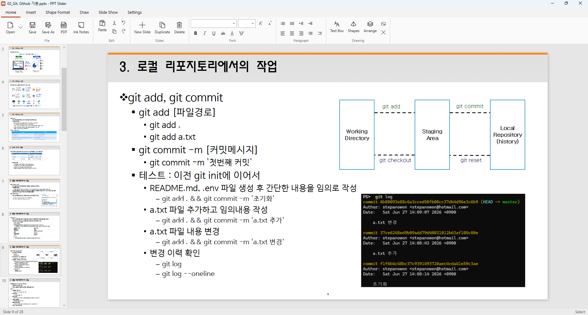
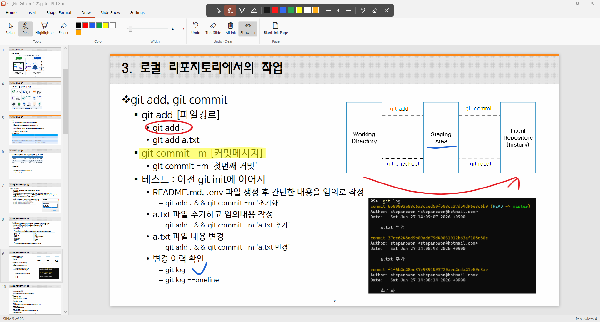
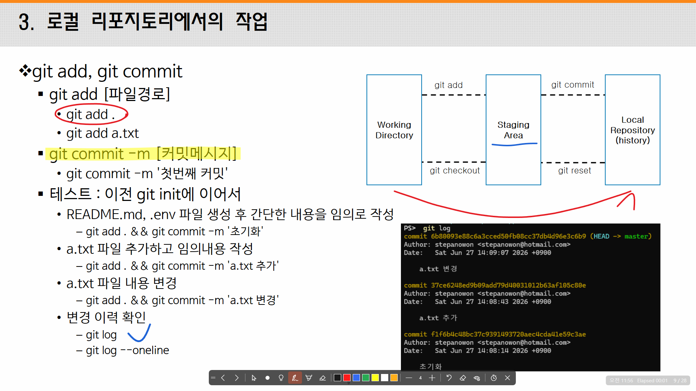
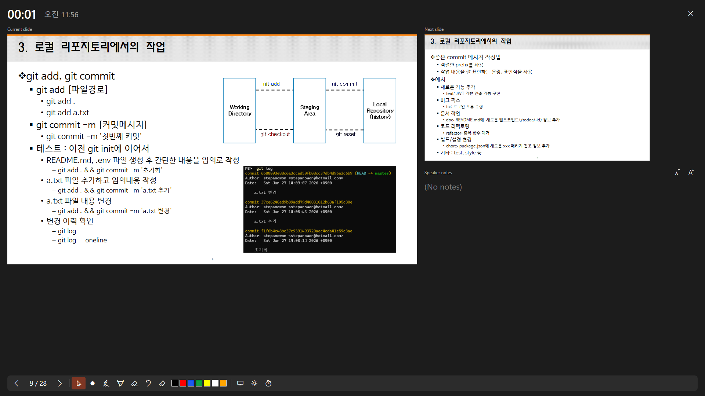
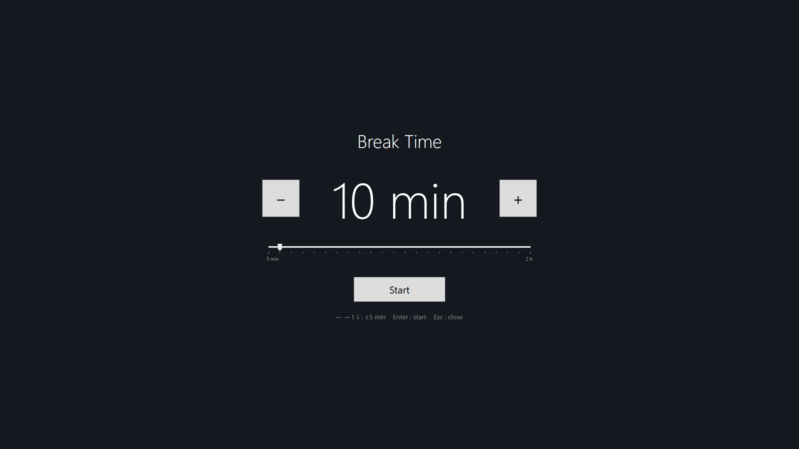
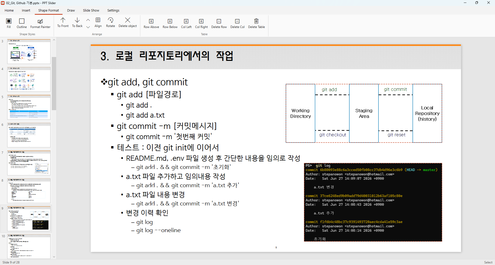

# PPT Slider

[한국어](README.md) | [日本語](README.ja.md) | **English**

A lightweight Windows app for opening `.pptx` files, making quick edits, and presenting while you draw on the screen.
It is built for lectures, classes and seminars, where you explain by writing directly over your slides. PowerPoint is not needed.

<a href="https://apps.microsoft.com/detail/9PL1M72JXSCN?mode=direct"></a>



## At a glance

- **Screen ink**: draw with a pen, highlighter, eraser or laser pointer over the editor, the slide show or any other app. Ink is remembered per slide.
- **Slide show and Presenter View**: choose the show monitor; current and next slides and notes on another monitor; black screen, spotlight, zoom and a break timer.
- **Editing**: in-place text editing, 19 shapes, tables, pictures, Format Painter, undo. Elements the app cannot display stay in the file as they are.
- **True to the original**: line spacing, bullets, Korean line wrapping and character spacing follow the same rules as PowerPoint.
- **Ink Notes**: export only the slides you drew on, with their ink, as a PDF to hand out as lecture notes.
- English, Korean and Japanese interface, fully customizable shortcuts, autosave and recovery. Nothing is sent over the internet.

## Installation

**Requirements**: Windows 10 version 1809 or later, or Windows 11, 64-bit (x64). .NET is included in the app, so there is nothing else to install.

### Microsoft Store (recommended)

1. Click the badge above, or search for "PPTSlider" in the Microsoft Store app.
2. Click **Get** (or **Install**).
3. Start **PPTSlider** from the Start menu.

To install from the command line (winget):

```powershell
winget install --id 9PL1M72JXSCN --source msstore
```

The Microsoft Store installs updates automatically. To get one right away, click **Library → Get updates** in the Store app.

### Portable zip (GitHub Releases)

Download `PptSlider-<version>-win-x64.zip` from the [releases page](https://github.com/stepanowon/ppt-slider/releases/latest), unzip it into any folder and run `PptSlider.exe`. There is no setup, and .NET is included.

- The executable is not signed, so the first run may show "Windows protected your PC". Click **More info → Run anyway**.
- It is not added to "Open with" automatically and does not update itself. Get new versions from the releases page.

### Opening .pptx files with PPTSlider

When installed from the Store, PPTSlider appears in the "Open with" list for .pptx files.

- Once: right-click the file → **Open with** → **PPTSlider**
- Always: in **Settings → Apps → Default apps**, search for `.pptx` and choose PPTSlider.

You can also drop a file onto the app window, or use **Open** (Ctrl+O) or **Recent files**.

### Uninstalling

In **Settings → Apps → Installed apps**, click **⋯ → Uninstall** next to PPTSlider. Recent files, autosaved copies and the shortcut and language settings are removed with it.
Your edited .pptx files and exported PDFs stay where they are. For the portable zip, just delete its folder.

## Quick start

1. Drop a `.pptx` file onto the app window.
2. On the **Slide Show** tab, choose the monitor for the show, and turn on **Use Presenter View** if you have two or more monitors.
3. Press **F5** to start from the beginning, or **Shift+F5** to start from the current slide.
4. In the show, draw with **P** (pen), **H** (highlighter) and **E** (eraser), change colors with **1–7**, and press **Esc** to go back to the pointer. Press **Esc** again to end the show.
5. Afterwards, use **Home → Ink Notes** to keep the slides you drew on as a PDF.

Press **F1** to see every shortcut.

## Screen ink



Ink is drawn on a transparent layer over the screen, not on the slide. So you can draw over the editor, the slide show and other apps too (the show's monitor during a show, otherwise the editor's).

- **Tools**: pen, highlighter, eraser, laser pointer (in the show), 7 colors (black, red, blue, green, yellow, white, orange), adjustable width.
- **Remembered per slide**: move to another slide and back, and the ink you drew there comes back. A black or white screen opens a fresh ink layer that doesn't mix with the slides' ink (it starts empty each time).
- **On-screen toolbar**: pointer (keep the ink and click the screen underneath), pen, highlighter, eraser, colors, width, undo, clear, hide. Drag its grip to move it anywhere.
- **Straight lines**: hold Shift while drawing.
- **Undo**: Ctrl+Z takes back ink strokes first when there are any. Ink undo remembers the last 200 changes on each slide.
- **Clear**: C clears the current slide's ink; **Draw → All Ink** clears the ink on every slide.
- **Blank ink page** (Ctrl+Enter): inserts a blank slide after the current one and switches to the pen, for when you need more room to write.
- Ink is not saved in the .pptx and is gone when the app closes. To keep it, export to PDF or Ink Notes.

## Slide show



Start from the beginning (F5) or from the current slide (Shift+F5), and choose the monitor for the show (default: the secondary monitor).

- **Advance**: click, mouse wheel, arrows, Space, Enter, PageDown and more. Type a number and press Enter to jump to that slide.
- **Black / white screen** (B / W): take the audience's eyes off the slide for a moment. You can draw on it too.
- **Laser pointer** (Ctrl+L), **spotlight** (S: a yellow circle around the mouse pointer, also while drawing).
- **Zoom** (Z, then drag an area; Esc to undo).
- **Toolbar**: at the bottom left, with previous / next, ink tools, laser, spotlight, break and end-show buttons.
- The current time and elapsed time appear at the bottom right, and the cursor hides after 3 seconds without mouse movement.
- The show does not stay on top of everything. During a show you can bring a browser or any other window in front of it, and go back to the show with the taskbar or Alt+Tab.

In the show, the number keys are shared by go-to-slide and pen colors. A single number with nothing after it for 1 second sets the pen color; Enter or another number within that time makes it a slide number.

## Presenter View



Turn on **Slide Show → Use Presenter View** to open Presenter View on a monitor other than the show's (it is not shown with a single monitor).

- The current slide, the next slide, speaker notes (adjustable text size), the current time and elapsed time.
- Ink tools picked in Presenter View draw on the show's screen. The laser pointer appears on the show even when you move it over the slide in Presenter View.
- Click the slide or use the mouse wheel to advance.
- Previous / next, black / white screen (showing what the audience sees), undo / clear ink, break and end-show buttons. It uses the same shortcuts as the show.

## Break Time



A full-screen break timer (T, or the break button on the Slide Show tab and the show toolbar).
Pick 5 minutes to 2 hours in 5-minute steps (arrow keys) and press Enter to start. It shows when class resumes; Space pauses and continues, Esc closes it.

## Editing

The ribbon has **Home, Insert, Shape Format, Draw, Slide Show and Settings** tabs. Edits change the OpenXML document directly, so elements the app cannot draw are kept as they are when you save.



### Objects

- Select: click, Shift/Ctrl+click, drag a marquee, Ctrl+A for all
- Drag to move, resize with eight handles (Shift keeps the aspect ratio), drag the circle on top to rotate, move with the arrow keys (Ctrl+arrows to nudge), Delete to delete
- Cut, copy and paste (across slides, pictures and text included), duplicate with Ctrl+D
- Order (to front, to back, forward, backward), align (left, center, right, top, middle, bottom: several objects to each other, one object to the slide), rotate 90°, flip vertical / horizontal
- **Format Painter**: click the brush button, then another object; or Ctrl+Shift+C / Ctrl+Shift+V
- Undo / redo (up to the last 100 edits)

### Text

- Double-click (or F2) to edit in place. The original font, size, color and alignment are kept; click outside to apply, Esc to cancel, Shift+Enter for a line break.
- Font, size, color, bold, italic, underline, strikethrough, text highlight color, increase / decrease font size.
  While editing, formatting applies only to the selected characters, and the font and size boxes show the values of the selected characters.
- Align left, center, right or justify, line spacing, bullets and numbering, list level (Alt+Shift+→ / ←).
- Text set to "shrink text on overflow" (normAutofit) is drawn smaller to fit its box.

### Shapes, tables and pictures

- **19 shapes**: rectangle, rounded rectangle, oval, triangle, right triangle, diamond, parallelogram, trapezoid, pentagon, hexagon, pentagon arrow, chevron, star, right / left / up / down arrows, line and arrow.
  Pick one and drag on the slide (Shift: square / circle). On the **Shape Format** tab, change the fill and outline color, weight and dashes (solid, dotted, dashed, long dash-dot).
- **Tables**: pick the number of rows × columns from a grid. Click a cell to edit it, move between cells with Tab / Shift+Tab, and Tab in the last cell adds a row. Insert rows above / below and columns left / right; delete rows, columns or the table. Merged cells are handled.
- **Text boxes** and **pictures**: the [Picture] button, paste with Ctrl+V, or drop an image file (png, jpg, gif, bmp).

### Slides

- New slide (Ctrl+M), duplicate, delete (deleting can't be undone, so it asks first).
- Drag thumbnails on the left to change the order.

## Open, save and export

- **Open**: drag and drop, "Open with", Ctrl+O. **Recent files** shows the last 10 files in the list next to the Open button and on the empty screen.
- **Save / Save As**: Ctrl+S / Ctrl+Shift+S. Closing with unsaved changes asks whether to save.
- **Autosave**: every 2 minutes a copy of the deck being edited is kept, and deleted on a normal exit. If the app ended abnormally, opening the same file again offers to recover the newer copy.
- **Export to PDF**: one page per slide, with or without ink.
- **Ink Notes**: only the slides you drew on, with their ink, as a PDF (the file name ends in `_ink-notes`).

## True to the original

Slides are laid out by the same rules as PowerPoint.

- A line is 1.2 times the font size, and a text box's first paragraph gets no space before it.
- Bullets hang in the indent, so the second and later lines start where the text starts.
- Korean text wraps by the document's setting (by word or by character), and a particle attached to an English word ("diff를") stays with it.
- Character spacing, slide number fields, tables' theme fonts, first-column emphasis and lightened / darkened colors, and very thin lines are shown.
- SmartArt is drawn from the picture PowerPoint saved in the file (drawing.xml).

Even with the same font, glyphs can differ by a few pixels. Character spacing is matched by scaling the paragraph horizontally, so letters can look slightly narrower or wider.

**Not displayed**: charts, effects (shadows etc.), table styles other than the default, animations, and SmartArt without a saved picture (only a placeholder box is shown). They are just not drawn on screen; they stay in the file unchanged.

## Settings

On the **Settings** tab:

- **Language**: 한국어, 日本語, English. By default the app follows the Windows display language (English when it is neither Korean nor Japanese); a change takes effect after a restart.
- **Shortcut Settings**: change the shortcut of every command, with several keys per command if you like. Picking a key that is already in use asks whether to move it. Reset one command or all of them to the defaults.
  Esc is a fixed key: it cancels text editing → ends the zoom → returns to the Select tool → ends the slide show, one at a time in that order.

### Default shortcuts

| Group | Command | Keys |
|---|---|---|
| Navigate | Next / previous slide | → ↓ PageDown Space Enter N / ← ↑ PageUp Backspace |
| Navigate | First / last slide | Home / End |
| Navigate | Go to slide by number (show) | Number + Enter |
| Ink | Pen / highlighter / eraser | P / H / E |
| Ink | Laser pointer | Ctrl+L |
| Ink | Colors 1–7 | 1–7 (numeric keypad too) |
| Ink | Thinner / thicker | `[` `-` / `]` `=` (numeric keypad `-` / `+` too) |
| Ink | Clear ink on this slide | C |
| Ink | Insert blank ink page | Ctrl+Enter |
| Show | From beginning / from current slide | F5 / Shift+F5 |
| Show | Black screen / white screen | B `.` / W `,` |
| Show | Zoom | Z |
| Show | Spotlight | S |
| Show | Break Time | T |
| File | Open / Save / Save As | Ctrl+O / Ctrl+S / Ctrl+Shift+S |
| Edit | Undo (ink first) / redo | Ctrl+Z / Ctrl+Y |
| Edit | Edit text / delete object | F2 / Delete |
| Edit | Cut / copy / paste / select all | Ctrl+X / Ctrl+C / Ctrl+V / Ctrl+A |
| Edit | Copy / paste formatting | Ctrl+Shift+C / Ctrl+Shift+V |
| Edit | Move objects (nudge) | Arrows (Ctrl+arrows) |
| Edit | To front / to back, forward / backward | Ctrl+Shift+] / Ctrl+Shift+[, Ctrl+] / Ctrl+[ |
| Edit | Increase / decrease list level | Alt+Shift+→ / Alt+Shift+← |
| Edit | Next / previous table cell | Tab / Shift+Tab |
| Edit | Bold / Italic / Underline | Ctrl+B / Ctrl+I / Ctrl+U |
| Edit | Increase / decrease font size | Ctrl+Shift+. / Ctrl+Shift+, |
| Slides | New slide / duplicate (the selected objects, if any) | Ctrl+M / Ctrl+D |
| Help | Shortcut list | F1 |

## Data and privacy

The app does not collect personal data or send anything over the internet ([privacy policy](PRIVACY.md)). These are the only files it writes:

| What | Where |
|---|---|
| Recent files, autosaved copies | `%LOCALAPPDATA%\PptSlider` |
| Language choice (`language.txt`), shortcuts (`shortcuts.json`) | `%APPDATA%\PptSlider` |

In a Store install these locations may be redirected to a package-private folder, which is removed when the app is uninstalled.

## Development

### Build

Requirements: Windows, [.NET 10 SDK](https://dotnet.microsoft.com/download). It is a WPF app with a single dependency, [DocumentFormat.OpenXml](https://www.nuget.org/packages/DocumentFormat.OpenXml).

```powershell
cd src
dotnet build -c Release
```

The output is `bin\Release\net10.0-windows\PptSlider.exe` at the repository root.
The build output folders (`bin/`, `obj/`) are moved to the root by `src/Directory.Build.props` and excluded from Git.

The portable zip is made from a self-contained publish:

```powershell
dotnet publish src\PptSlider.csproj -c Release -r win-x64 --self-contained true -o out\PptSlider-<version>-win-x64
```

### Diagnostic modes

Command-line options make `PptSlider.exe` run checks without a window or off screen.

| Command | What it does | Output |
|---|---|---|
| `--selftest deck.pptx outDir` | Self-test (below) | `outDir\selftest.txt`; exit code 0 means pass |
| `--render deck.pptx outDir [width]` | Saves every slide as PNG (width 1280 by default), to put side by side with the images PowerPoint exports and see where rendering differs | `outDir\01.png`, `02.png` … |
| `--leak deck.pptx outDir` | Memory measurement (below) | `outDir\leak.txt` |
| `--screenshots deck.pptx outDir [ko\|ja\|en] [slide index (from 0)]` | Captures the `screen/` images for the README and the Store from the real screen | `outDir\*.png` |

The **self-test** renders every slide and checks the edit → save → reopen round trip, plus the slide show, Presenter View, screen ink, picture insert, reordering, text autofit, shapes, tables, clipboard, Format Painter, mouse / keyboard editing, duplicate shortcuts, PDF, SmartArt, recent files, autosave and the UI text in all three languages.
It also checks the rules for drawing like PowerPoint (line height, bullets, Korean wrapping, character spacing and more), memory leaks (closed show windows are freed), the undo limits, and that the show is not always on top.
The show and presenter windows open off screen and key presses go only to them, so you can keep working while it runs. App data goes to `outDir\local`, so your real recent files and autosaves are not touched. The self-test always runs in Korean.

The **memory measurement** repeats slide navigation, opening and closing the show, reopening the file, text editing, moving shapes, ink and opening and closing windows dozens of times, and records the memory after each GC and whether closed windows and old documents were freed.
The environment variables `LEAK_OPENS` (how many times to reopen the file, 40 by default) and `LEAK_COMPACT` (1: compact the large object heap, 2: a GC that gives free memory back to Windows) change how it measures.

The **screenshots** mode opens the editor on the primary monitor and captures the editor, ink over the editor, Shape Format (several objects selected), ink in the slide show, Break Time, and Presenter View (with the show on another monitor) in turn. It captures the screen as it is, so leave the mouse and keyboard alone while it runs. Presenter View is captured only with two or more monitors.

### MSIX package

```powershell
.\build-msix.ps1           # for local testing (self-signed)
.\build-msix.ps1 -Store    # for Store submission (unsigned)
```

The script runs a self-contained publish → adds `Package\AppxManifest.xml` and the `Package\Assets` logos to the layout → `makeappx pack` → signs.
The result is `bin\msix\PptSlider_<version>_x64.msix`. The package version follows `Version` in `src\PptSlider.csproj`.
Without a Windows SDK, it downloads the NuGet package `Microsoft.Windows.SDK.BuildTools` (which contains `makeappx` and `signtool`) to `obj\tools`.

The manifest declares a full-trust (runFullTrust) desktop app, the `.pptx` file association, and Korean, Japanese and English (ko-KR, ja-JP, en-US) resources.
The logos can be redrawn with `Package\make-assets.ps1`.

**Local test install**: the script creates a self-signed certificate whose name matches the manifest's Publisher in `Cert:\CurrentUser\My` (reusing it if it already exists) and exports it to `bin\msix\PptSlider-test.cer`.
Trust this certificate once, then install (administrator PowerShell):

```powershell
Import-Certificate -FilePath bin\msix\PptSlider-test.cer -CertStoreLocation Cert:\LocalMachine\TrustedPeople
Add-AppxPackage bin\msix\PptSlider_<version>_x64.msix
```

### Microsoft Store submission

1. Reserve the app name in [Partner Center](https://partner.microsoft.com/dashboard).
2. Update `Package\AppxManifest.xml` with the values on the **Product management → Product identity** page.
   - `Name` of `Identity` ← Package/Identity/Name
   - `Publisher` of `Identity` ← Package/Identity/Publisher (in the form `CN=XXXXXXXX-...`, copy it exactly)
   - `PublisherDisplayName` ← Package/Properties/PublisherDisplayName
   - `DisplayName` and the `DisplayName` of `uap:VisualElements` ← the reserved app name
3. Raise `Version` in `src\PptSlider.csproj`. The Store does not accept the same version twice.
4. Upload the `.msix` built with `.\build-msix.ps1 -Store` to the Packages section of the submission. The Store signs it.
5. `runFullTrust` is a restricted capability, so the submission must explain why it is used (e.g. "A WPF desktop app that reads and writes the .pptx files the user opens").

The Store asks for a Store listing (description, screenshots) in each of the three languages. The listing text is in [docs/store-listing.md](docs/store-listing.md), the poster art, box art and icons in `Package\StoreArt` (`Package\make-store-art.ps1`), and the privacy policy in [PRIVACY.md](PRIVACY.md).

> **About the app name**: "PPT" is associated with Microsoft PowerPoint and may be flagged as a trademark issue in Store certification.
> It is safer to keep "PPT" and "PowerPoint" out of the reserved name, and to mention the file format only, e.g. "opens .pptx files", in the description.

### Folder structure

```
build-msix.ps1          Builds the MSIX package
Package/                AppxManifest.xml, Assets (logos), StoreArt (Store images), make-assets.ps1, make-store-art.ps1
screen/                 screenshots for the README and the Store (ko, ja, en)
docs/                   store-listing.md (Store listing text), test plans and reports per version (Korean)
src/
├─ App.xaml(.cs)        Entry point (--selftest, --screenshots, --render, --leak, opening a file at startup)
├─ Views/               MainWindow (editor), ShowWindow (slide show), PresenterWindow (Presenter View),
│                       InkOverlay (screen ink), BreakWindow (break timer), ShortcutsWindow (shortcut settings),
│                       PenToolbar (ink tool bar), WindowHooks (unhooks event handlers when a window closes)
├─ Editing/             Editing parts (depend only on IEditorHost): ShapeSelection, SelectionAdorner (handles), StageInteraction (mouse),
│                       TextEditor (in-place text editing), Shape · Text · Table · Insert · ClipboardCommands, FormatPainterTool,
│                       EditingParts (wires the parts together)
├─ Models/              Deck (.pptx document · saving · slide list), EditHistory (undo), ShapeFactory · ShapeLayout · ShapeStyle (shapes),
│                       Tables, TextContent · TextFormat (text and its format), ShapeClipboard · FormatPainter (copying), SlideTree · Ooxml · X (XML helpers),
│                       PenState (ink tool state), InkManager (per-slide, desktop and blank-screen ink), InkHistory (ink undo),
│                       ShowSession (show state: blank screen, typed slide number, laser, spotlight), BoundedStack (size-limited undo)
├─ Rendering/           SlideRenderer (PPTX → WPF rendering, including SmartArt), ShapeGeometry (shape outlines), ColorMath (colors), FontNames (font name check), TextPanel, ShapeHit
├─ Services/            Shortcuts, Monitors (monitor list), PdfExport (PDF),
│                       RecentFiles, AutoSave, AppPaths (app data folder), Loc (Korean · Japanese · English UI text)
└─ Diagnostics/         SelfTest (editing · show · ink · viewer · rendering rule · memory leak checks), Screenshots (screenshots),
                        RenderDump (--render), LeakProbe (--leak)
```

## License

[MIT License](LICENSE). Anyone may use, modify and redistribute it as long as the copyright notice and license text are kept.
The licenses of the bundled third-party components (Open XML SDK, .NET runtime) are in [THIRD-PARTY-NOTICES.txt](THIRD-PARTY-NOTICES.txt), which also ships with the build output and the MSIX package.
