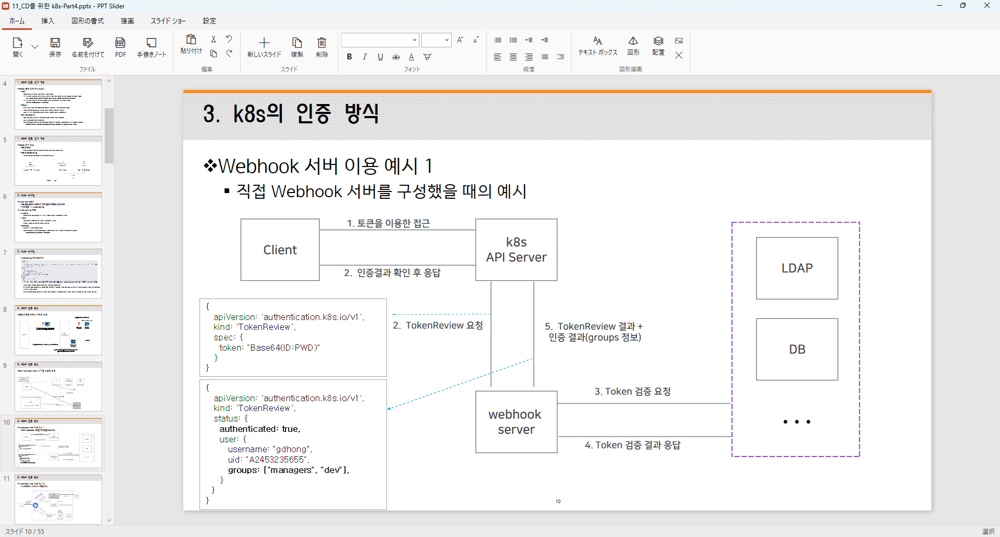
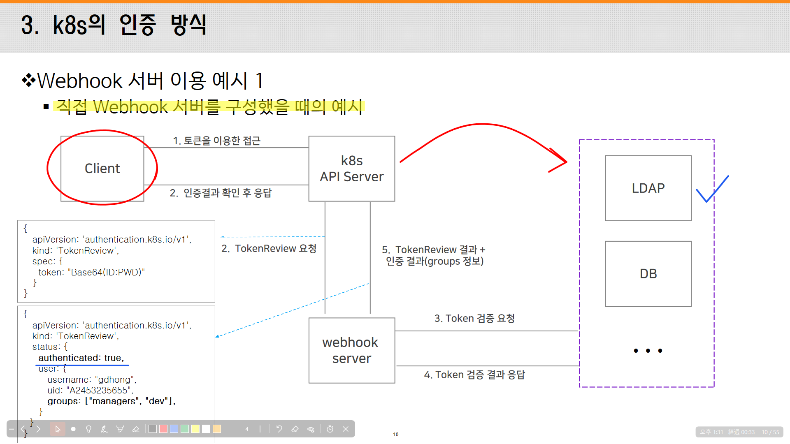
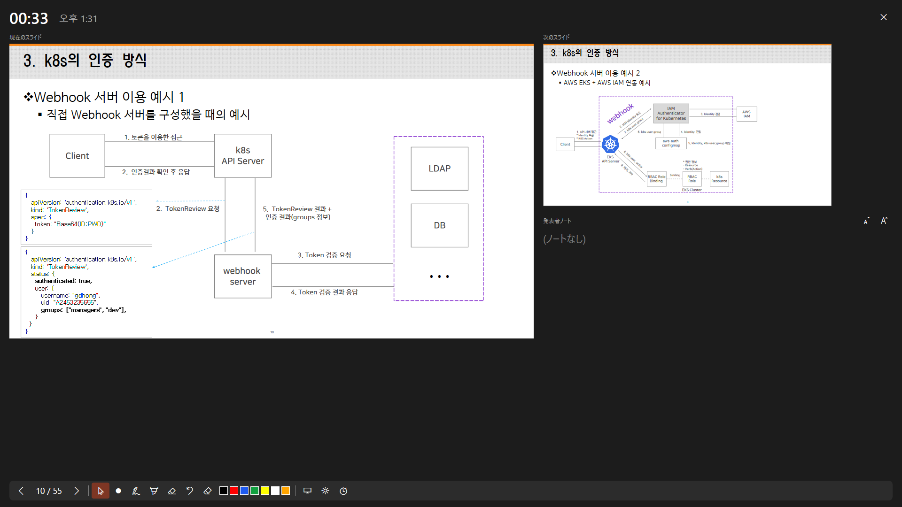
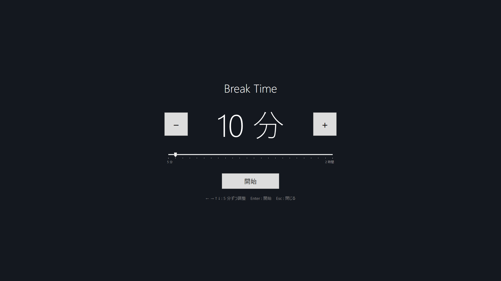
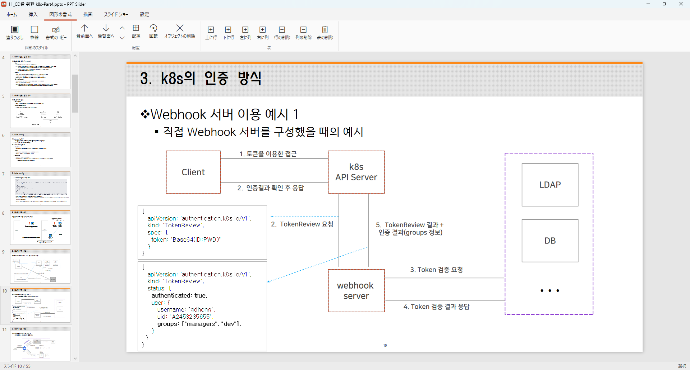

# PPT Slider

[한국어](README.md) | **日本語** | [English](README.en.md)

`.pptx` ファイルを開いて手軽に編集し、スライド ショーに手書きしながら発表できる軽量な Windows アプリです。
講義、授業、セミナーなど、スライドに直接書き込みながら説明する発表のために作りました。PowerPoint は必要ありません。

<a href="https://apps.microsoft.com/detail/9PL1M72JXSCN?mode=direct"></a>



## 概要

- **ショーでの手書き**: スライド ショーの上にペン・蛍光ペン・消しゴム・レーザー ポインターで描きます。手書きはスライドごとに記憶されます。編集画面では手書きしません。
- **スライド ショーと発表者ツール**: 表示モニターの選択、別のモニターに現在と次のスライドとノート、黒い画面・スポット ハイライト・画面の拡大・休憩タイマー。
- **編集**: テキストのその場編集、19 種類の図形、表、画像、書式のコピー、元に戻す。アプリが表示できない要素もファイルにそのまま残ります。
- **元のファイルに近い表示**: 行間、箇条書き、韓国語の改行、文字間隔を PowerPoint と同じ規則で描画します。
- **手書きノート**: 手書きしたスライドだけを手書きと一緒に PDF に出力し、講義ノートとして配布できます。
- 日本語・韓国語・英語の画面、すべてのショートカットの変更、自動保存と復元。インターネットには何も送信しません。

## インストール

**必要環境**: Windows 10 バージョン 1809 以降または Windows 11、64 ビット (x64)。.NET はアプリに含まれているため、別途インストールする必要はありません。

### Microsoft Store (推奨)

1. 上のバッジをクリックするか、Microsoft Store アプリで「PPTSlider」を検索します。
2. **入手** (または **インストール**) をクリックします。
3. スタート メニューから **PPTSlider** を起動します。

コマンド ラインでインストールするには (winget):

```powershell
winget install --id 9PL1M72JXSCN --source msstore
```

更新は Microsoft Store が自動でインストールします。すぐに入手するには、Store アプリの **ライブラリ → 更新プログラムを取得する** をクリックします。

### ポータブル zip (GitHub リリース)

[リリース ページ](https://github.com/stepanowon/ppt-slider/releases/latest)から `PptSlider-<バージョン>-win-x64.zip` をダウンロードし、任意のフォルダーに展開して `PptSlider.exe` を実行します。インストール作業は不要で、.NET も含まれています。

- 署名されていない実行ファイルのため、初回実行時に「Windows によって PC が保護されました」と表示されることがあります。**詳細情報 → 実行** をクリックします。
- 「プログラムから開く」には自動で追加されず、自動更新もありません。新しいバージョンはリリース ページから入手します。

### .pptx ファイルを PPTSlider で開く

Store からインストールすると、.pptx ファイルの「プログラムから開く」一覧に PPTSlider が追加されます。

- 1 回だけ: ファイルを右クリック → **プログラムから開く** → **PPTSlider**
- 常に: **設定 → アプリ → 既定のアプリ** で `.pptx` を検索し、PPTSlider を選びます。

アプリのウィンドウにファイルをドラッグ アンド ドロップするか、**開く** (Ctrl+O)、**最近使ったファイル** から開くこともできます。

### アンインストール

**設定 → アプリ → インストールされているアプリ** で PPTSlider の **⋯ → アンインストール** をクリックします。最近使ったファイル、自動保存のコピー、ショートカットと言語の設定も一緒に削除されます。
編集した .pptx ファイルとエクスポートした PDF はそのまま残ります。ポータブル zip はフォルダーを削除するだけです。

## はじめに

1. `.pptx` ファイルをアプリのウィンドウにドラッグ アンド ドロップします。
2. **スライド ショー** タブで表示するモニターを選び、モニターが 2 台以上あれば **発表者ツールを使用** をオンにします。
3. **F5** で最初から、**Shift+F5** で現在のスライドからスライド ショーを開始します。
4. ショー中は **P** (ペン)・**H** (蛍光ペン)・**E** (消しゴム) で手書きし、**1～7** で色を変え、**Esc** でポインターに戻ります。もう一度 **Esc** を押すとショーが終了します。
5. 終了後、**ホーム → 手書きノート** で手書きしたスライドを PDF に残します。

**F1** を押すと、すべてのショートカットを確認できます。

## 手書き (スライド ショー専用)



手書きは **スライド ショーでのみ** 使えます。ショー画面の上の透明なレイヤーに描かれ、スライド自体は変わりません。編集画面ではペン・蛍光ペン・消しゴムを選べず (**描画** タブのボタンはショー以外ではオフ)、編集画面の上に手書きは表示されません。**描画** タブで色と太さを決めておくと、ショーでそのまま使えます。

- **ツール**: ペン、蛍光ペン、消しゴム、レーザー ポインター (ショー中)、7 色 (黒・赤・青・緑・黄・白・オレンジ)、太さの調整。
- **スライドごとに記憶**: スライドを切り替えて戻ると、そのスライドで描いた手書きが再び表示されます。黒い画面・白い画面では新しい空の手書きレイヤーが開き、スライドの手書きとは混ざりません (表示するたびに空の状態から始まります)。
- **画面上のツールバー**: ポインター (手書きを残したまま下の画面をクリック)・ペン・蛍光ペン・消しゴム・色・太さ・元に戻す・消去・非表示。つまみをドラッグして好きな場所に移動できます。
- **直線**: Shift を押しながら描くと直線になります。
- **元に戻す**: Ctrl+Z は手書きがあれば手書きのストロークから元に戻します。手書きの元に戻すはスライドごとに直近 200 回まで記憶します。
- **消去**: C で現在のスライドの手書きを、**描画 → すべての手書き** ですべてのスライドの手書きを消します。
- **空白の手書きページ** (Ctrl+Enter): 現在のスライドの後に空のスライドを挿入し、ショー中ならペンに切り替えます。書く場所がもっと必要なときに使います。
- ショーを終えると手書きは画面から消えますが、スライドごとに残り、次のショーや PDF・手書きノートに含まれます。.pptx には保存されず、アプリを閉じると消えます。残すには PDF または手書きノートにエクスポートしてください。

## スライド ショー

最初から (F5) または現在のスライドから (Shift+F5) 開始し、表示するモニターを選べます (既定: セカンダリ モニター)。

- **スライドを進める**: クリック、マウス ホイール、矢印・Space・Enter・PageDown など。番号を入力して Enter でそのスライドに移動します。
- **黒い画面 / 白い画面** (B / W): 聴衆の視線をいったんスライドから外します。その上に手書きもできます。
- **レーザー ポインター** (Ctrl+L)、**スポット ハイライト** (S: マウス ポインターの周りに黄色い円、手書き中も表示)。
- **画面の拡大** (Z を押して範囲をドラッグ、Esc で解除)。
- **ツールバー**: 左下に前へ・次へ、手書きツール、レーザー、スポット ハイライト、休憩、ショーの終了のボタンがあります。
- 右下に現在時刻と経過時間を表示し、マウスを 3 秒動かさないとカーソルを隠します。
- スライド ショーは常に最前面ではありません。ショー中でもブラウザーなどほかのウィンドウをショーの上に表示して見せられ、タスク バーまたは Alt+Tab でショーに戻ります。

スライド ショーでは、数字キーが番号での移動とペンの色で重なっています。数字を 1 つだけ押して 1 秒たつとペンの色、その間に Enter または次の数字が来ると番号の入力として扱います。

## 発表者ツール



**スライド ショー → 発表者ツールを使用** をオンにすると、スライド ショーとは別のモニターに発表者ツールを表示します (モニターが 1 台のときは表示しません)。

- 現在のスライド、次のスライド、発表者ノート (文字サイズ調整可)、現在時刻と経過時間。
- 発表者ツールで選んだ手書きツールはスライド ショーの画面上に描きます。レーザー ポインターは発表者ツールのスライド上で動かしてもスライド ショーに表示されます。
- スライドのクリックまたはマウス ホイールで進めます。
- 前へ・次へ、黒い画面・白い画面 (聴衆の画面の状態を表示)、手書きの元に戻す・消去、休憩、ショーの終了のボタン。スライド ショーと同じショートカットが使えます。

## Break Time



全画面の休憩タイマーです (T、またはスライド ショー タブ・ショーのツールバーの休憩ボタン)。
5 分～2 時間を 5 分単位で選び (矢印キー)、Enter で開始します。再開する時刻を表示し、Space で一時停止・再開、Esc で閉じます。

## 編集

リボンは **ホーム・挿入・図形の書式・描画・スライド ショー・設定** タブで構成されています。編集は OpenXML ドキュメントを直接変更するため、アプリが描画できない要素も保存後そのまま残ります。



### オブジェクトの操作

- 選択: クリック、Shift/Ctrl+クリック、ドラッグで範囲選択、Ctrl+A ですべて選択
- ドラッグで移動、8 方向のハンドルでサイズ変更 (Shift: 縦横比を維持)、上の円をドラッグして回転、矢印キーで移動 (Ctrl+矢印: 微調整)、Delete で削除
- 切り取り・コピー・貼り付け (別のスライドへ、画像とテキストを含む)、Ctrl+D で複製
- 順序 (最前面・最背面・前面・背面)、配置 (左・左右中央・右・上・上下中央・下: 複数なら互いに、1 つならスライドに)、90 度回転・上下 / 左右反転
- **書式のコピー**: ブラシ ボタンを押してから別のオブジェクトをクリック、または Ctrl+Shift+C / Ctrl+Shift+V
- 元に戻す / やり直し (直近 100 回の編集まで)

### テキスト

- ダブルクリック (または F2) でその場で編集。元のフォント・サイズ・色・配置を維持し、外側をクリックすると適用、Esc でキャンセル、Shift+Enter で改行します。
- フォント・サイズ・色、太字・斜体・下線・取り消し線、蛍光ペンの色、フォント サイズの拡大 / 縮小。
  編集中は選択した文字だけに適用され、フォントとサイズのボックスには選択した文字の値が表示されます。
- 左揃え・中央揃え・右揃え・両端揃え、行間、箇条書き・段落番号、インデントの増減 (Alt+Shift+→ / ←)。
- 「はみ出す場合だけ自動調整する」(normAutofit) が設定されたテキストは、ボックスに収まるように縮小して描画します。

### 図形・表・画像

- **19 種類の図形**: 四角形、角丸四角形、楕円、二等辺三角形、直角三角形、ひし形、平行四辺形、台形、正五角形、六角形、ホームベース、山形、星、上下左右の矢印、直線、矢印。
  選んでからスライド上でドラッグして描きます (Shift: 正方形 / 円)。**図形の書式** タブで塗りつぶしと枠線の色、太さ、実線/点線 (実線・点線・破線・長破線と点) を変更します。
- **表**: マス目で行 × 列の数を選んで挿入します。セルをクリックしてそのまま編集し、Tab / Shift+Tab でセルを移動、最後のセルで Tab を押すと行を追加します。上・下に行、左・右に列を挿入し、行・列・表を削除できます。結合セルにも対応しています。
- **テキスト ボックス**、**画像**: [画像] ボタン、Ctrl+V で貼り付け、画像ファイルのドラッグ アンド ドロップ (png・jpg・gif・bmp)。

### スライド

- 新しいスライド (Ctrl+M)、複製、削除 (削除は元に戻せないため確認します)。
- 左のサムネイルをドラッグして順序を変更します。

## 開く・保存・エクスポート

- **開く**: ドラッグ アンド ドロップ、「プログラムから開く」、Ctrl+O。**最近使ったファイル** は最近の 10 件を [開く] ボタン横の一覧と空の画面に表示します。
- **保存 / 名前を付けて保存**: Ctrl+S / Ctrl+Shift+S。保存せずに閉じると保存するか確認します。
- **自動保存**: 2 分ごとに編集中のドキュメントのコピーを保管し、正常終了すると削除します。異常終了後に同じファイルを開くと、より新しいコピーから復元するか確認します。
- **PDF にエクスポート**: スライドごとに 1 ページずつ出力し、手書きを含めるかどうかを選べます。
- **手書きノート**: 手書きしたスライドだけを手書きと一緒に PDF に出力します (ファイル名の末尾に `_手書きノート`)。

## 元のファイルに近い表示

スライドは PowerPoint と同じ規則で配置します。

- 1 行の高さはフォント サイズの 1.2 倍で、テキスト ボックスの最初の段落には段落前の間隔を入れません。
- 箇条書きはぶら下げインデントにし、2 行目以降は本文の位置から始まります。
- 韓国語の改行は文書の設定 (単語単位 / 文字単位) に従い、英単語に続く助詞 ("diff를") は切り離しません。
- 文字間隔、スライド番号のフィールド、表のテーマ フォント・最初の列の強調・明るく / 暗くした色、ごく細い線を反映します。
- SmartArt は PowerPoint がファイルに保存した図 (drawing.xml) で描画します。

同じフォントでも、文字の形は数ピクセル異なることがあります。文字間隔は段落を横方向に拡大縮小して合わせるため、文字が少し細く、または太く見えることがあります。

**表示しない要素**: グラフ、効果 (影など)、既定以外の表のスタイル、アニメーション、保存された図がない SmartArt (プレースホルダーの枠だけを表示)。画面に描画しないだけで、ファイルにはそのまま残ります。

## 設定

**設定** タブで変更します。

- **言語**: 한국어・日本語・English。既定では Windows の表示言語に従い (韓国語・日本語以外は英語)、変更すると再起動後に適用されます。
- **ショートカットの設定**: すべてのコマンドのショートカットを変更でき、1 つのコマンドに複数のキーを割り当てられます。既に使われているキーを選ぶと移動するか確認します。コマンドごと・すべての既定値へのリセットに対応しています。
  Esc は固定キーで、テキスト編集のキャンセル → 拡大の解除 → 選択ツールに戻る → スライド ショーの終了の順に 1 つずつ処理します。

### 既定のショートカット

| 分類 | コマンド | キー |
|---|---|---|
| 移動 | 次 / 前のスライド | → ↓ PageDown Space Enter N / ← ↑ PageUp Backspace |
| 移動 | 最初 / 最後のスライド | Home / End |
| 移動 | 番号で移動 (スライド ショー) | 数字 + Enter |
| 手書き | ペン / 蛍光ペン / 消しゴム | P / H / E |
| 手書き | レーザー ポインター | Ctrl+L |
| 手書き | 色 1～7 | 1～7 (テンキーを含む) |
| 手書き | 細く / 太く | `[` `-` / `]` `=` (テンキーの `-` / `+` を含む) |
| 手書き | このスライドの手書きを消去 | C |
| 手書き | 空白の手書きページを挿入 | Ctrl+Enter |
| ショー | 最初から / 現在のスライドから | F5 / Shift+F5 |
| ショー | 黒い画面 / 白い画面 | B `.` / W `,` |
| ショー | 画面の拡大 | Z |
| ショー | スポット ハイライト | S |
| ショー | Break Time | T |
| ファイル | 開く / 保存 / 名前を付けて保存 | Ctrl+O / Ctrl+S / Ctrl+Shift+S |
| 編集 | 元に戻す (ショー中は手書きを優先) / やり直し | Ctrl+Z / Ctrl+Y |
| 編集 | テキストの編集 / オブジェクトの削除 | F2 / Delete |
| 編集 | 切り取り / コピー / 貼り付け / すべて選択 | Ctrl+X / Ctrl+C / Ctrl+V / Ctrl+A |
| 編集 | 書式のコピー / 書式の貼り付け | Ctrl+Shift+C / Ctrl+Shift+V |
| 編集 | オブジェクトの移動 (微調整) | 矢印 (Ctrl+矢印) |
| 編集 | 最前面 / 最背面へ、前面 / 背面へ | Ctrl+Shift+] / Ctrl+Shift+[、Ctrl+] / Ctrl+[ |
| 編集 | インデントを増やす / 減らす | Alt+Shift+→ / Alt+Shift+← |
| 編集 | 表で次 / 前のセル | Tab / Shift+Tab |
| 編集 | 太字 / 斜体 / 下線 | Ctrl+B / Ctrl+I / Ctrl+U |
| 編集 | フォント サイズの拡大 / 縮小 | Ctrl+Shift+. / Ctrl+Shift+, |
| スライド | 新しいスライド / 複製 (選択したオブジェクトがあればオブジェクト) | Ctrl+M / Ctrl+D |
| ヘルプ | ショートカット一覧 | F1 |

## データとプライバシー

アプリは個人情報を収集せず、インターネットに何も送信しません ([プライバシー ポリシー](PRIVACY.md))。アプリが書き込むファイルは次のものだけです。

| 内容 | 場所 |
|---|---|
| 最近使ったファイル、自動保存のコピー | `%LOCALAPPDATA%\PptSlider` |
| 言語の選択 (`language.txt`)、ショートカット (`shortcuts.json`) | `%APPDATA%\PptSlider` |

Store からインストールしたアプリでは、これらの場所がパッケージ専用フォルダーにリダイレクトされる場合があり、アプリをアンインストールすると一緒に削除されます。

## 開発

### ビルド

必要なもの: Windows、[.NET 10 SDK](https://dotnet.microsoft.com/download)。WPF アプリで、依存パッケージは [DocumentFormat.OpenXml](https://www.nuget.org/packages/DocumentFormat.OpenXml) だけです。

```powershell
cd src
dotnet build -c Release
```

出力はリポジトリ ルートの `bin\Release\net10.0-windows\PptSlider.exe` にできます。
ビルド出力 (`bin/`、`obj/`) は `src/Directory.Build.props` でルートに指定しており、Git から除外されます。

ポータブル zip は self-contained で発行して作ります。

```powershell
dotnet publish src\PptSlider.csproj -c Release -r win-x64 --self-contained true -o out\PptSlider-<バージョン>-win-x64
```

### 診断モード

`PptSlider.exe` にコマンド ライン オプションを付けると、ウィンドウを表示せずに、または画面外で検査を実行します。

| コマンド | 内容 | 結果 |
|---|---|---|
| `--selftest deck.pptx outDir` | セルフテスト (下記) | `outDir\selftest.txt`、終了コード 0 なら合格 |
| `--render deck.pptx outDir [幅]` | すべてのスライドを PNG で保存 (既定の幅 1280)。PowerPoint でエクスポートした画像と並べて描画の違いを確かめます。 | `outDir\01.png`、`02.png` … |
| `--leak deck.pptx outDir` | メモリの測定 (下記) | `outDir\leak.txt` |
| `--screenshots deck.pptx outDir [ko\|ja\|en] [スライド番号 (0 から)]` | README・Store 用の `screen/` の画像を実際の画面からキャプチャ | `outDir\*.png` |

**セルフテスト** はすべてのスライドをレンダリングし、編集 → 保存 → 再度開く流れと、スライド ショー・発表者ツール・ショーでの手書き (編集画面では不可)・画像の挿入・順序の変更・テキストの自動調整・図形・表・クリップボード・書式のコピー・マウス / キーボードでの編集・ショートカットの重複・PDF・SmartArt・最近使ったファイル・自動保存・3 言語の UI 文字列を検査します。
PowerPoint と同じように描画する規則 (行の高さ、箇条書き、韓国語の改行、文字間隔など)、メモリ リーク (閉じたショーのウィンドウが解放されるか)、元に戻すの上限、ショーが常に最前面でないことも確認します。
スライド ショーと発表者ツールのウィンドウは画面外に表示し、キー入力もそのウィンドウにだけ送るため、実行中に他の作業をしてもかまいません。アプリ データは `outDir\local` を使うため、実際の最近使ったファイルや自動保存には影響しません。セルフテストは常に韓国語で実行されます。

**メモリの測定** は、スライドの移動、ショーの開始と終了、ファイルを開き直す、テキストの編集、オブジェクトの移動、手書き、ウィンドウの開閉などを数十回ずつ繰り返し、GC 後のメモリと、閉じたウィンドウや前の文書が解放されたかを記録します。
環境変数 `LEAK_OPENS` (ファイルを開き直す回数、既定 40) と `LEAK_COMPACT` (1: ラージ オブジェクト ヒープの圧縮、2: 空きメモリを Windows に返す GC) で測定方法を変えられます。

**スクリーンショット** モードは、メイン モニターにエディターを表示し、編集画面、図形の書式 (複数のオブジェクトを選択)、スライド ショーの手書き、Break Time、発表者ツール (スライド ショーは別のモニター) を順にキャプチャします。画面をそのまま撮影するため、実行中はマウスとキーボードに触れないでください。発表者ツールはモニターが 2 台以上のときだけ撮影します。

### MSIX パッケージ

```powershell
.\build-msix.ps1           # ローカル テスト用 (自己署名)
.\build-msix.ps1 -Store    # Store 提出用 (署名なし)
```

self-contained publish → `Package\AppxManifest.xml` と `Package\Assets` のロゴを加えたレイアウト → `makeappx pack` → 署名の順に進み、
結果は `bin\msix\PptSlider_<バージョン>_x64.msix` です。パッケージのバージョンは `src\PptSlider.csproj` の `Version` に従います。
Windows SDK がない場合は、`makeappx`・`signtool` を含む NuGet パッケージ `Microsoft.Windows.SDK.BuildTools` を `obj\tools` にダウンロードして使います。

マニフェストには、完全信頼 (runFullTrust) のデスクトップ アプリ、`.pptx` のファイル関連付け、韓国語・日本語・英語 (ko-KR、ja-JP、en-US) のリソースが含まれています。
ロゴは `Package\make-assets.ps1` で描き直せます。

**ローカル テスト インストール**: スクリプトはマニフェストの Publisher と同じ名前の自己署名証明書を `Cert:\CurrentUser\My` に作成し (既にあれば再利用)、`bin\msix\PptSlider-test.cer` にエクスポートします。
この証明書を一度だけ信頼済みとして登録してからインストールします (管理者の PowerShell):

```powershell
Import-Certificate -FilePath bin\msix\PptSlider-test.cer -CertStoreLocation Cert:\LocalMachine\TrustedPeople
Add-AppxPackage bin\msix\PptSlider_<バージョン>_x64.msix
```

### Microsoft Store への提出

1. [パートナー センター](https://partner.microsoft.com/dashboard)でアプリ名を予約します。
2. **製品管理 → 製品 ID** ページの値で `Package\AppxManifest.xml` を修正します。
   - `Identity` の `Name` ← Package/Identity/Name
   - `Identity` の `Publisher` ← Package/Identity/Publisher (`CN=XXXXXXXX-...` の形式、そのままコピー)
   - `PublisherDisplayName` ← Package/Properties/PublisherDisplayName
   - `DisplayName` と `uap:VisualElements` の `DisplayName` ← 予約したアプリ名
3. `src\PptSlider.csproj` の `Version` を上げます。Store は同じバージョンを再度受け付けません。
4. `.\build-msix.ps1 -Store` で作成した `.msix` を提出の [パッケージ] にアップロードします。署名は Store が行います。
5. `runFullTrust` は制限付き機能のため、提出時に使用理由を記入する必要があります (例: 「WPF デスクトップ アプリで、ユーザーが開いた .pptx ファイルを読み書きします」)。

Store ではこの 3 言語それぞれのストア掲載情報 (説明・スクリーンショット) が必要です。掲載の文言は [docs/store-listing.md](docs/store-listing.md)、ポスター アート・ボックス アート・アイコンは `Package\StoreArt` (`Package\make-store-art.ps1`)、プライバシー ポリシーは [PRIVACY.md](PRIVACY.md) にあります。

> **アプリ名の注意**: 「PPT」は Microsoft PowerPoint を連想させる名前のため、Store の審査で商標の問題を指摘される可能性があります。
> 予約する名前には「PPT」・「PowerPoint」を入れないほうが安全で、説明では「.pptx ファイルを開く」のようにファイル形式としてだけ触れることをお勧めします。

### フォルダー構成

```
build-msix.ps1          MSIX パッケージのビルド
Package/                AppxManifest.xml、Assets (ロゴ)、StoreArt (Store 用画像)、make-assets.ps1、make-store-art.ps1
screen/                 README と Store 用のスクリーンショット (ko、ja、en)
docs/                   store-listing.md (Store の一覧の文言)、テスト計画・テスト結果 (バージョンごと、韓国語)
src/
├─ App.xaml(.cs)        エントリ ポイント (--selftest・--screenshots・--render・--leak の処理、起動時にファイルを開く)
├─ Views/               MainWindow (エディター)、ShowWindow (スライド ショー)、PresenterWindow (発表者ツール)、
│                       InkOverlay (ショー上の手書きレイヤー)、BreakWindow (休憩タイマー)、ShortcutsWindow (ショートカットの設定)、
│                       PenToolbar (手書きツール バー)、WindowHooks (ウィンドウを閉じるときにイベントの登録を解除)
├─ Editing/             編集の部品 (IEditorHost だけに依存): ShapeSelection (選択)、SelectionAdorner (ハンドル)、StageInteraction (マウス)、
│                       TextEditor (その場でのテキスト編集)、Shape・Text・Table・Insert・ClipboardCommands (コマンド)、FormatPainterTool (書式のコピー)、
│                       EditingParts (部品の組み立て)
├─ Models/              Deck (.pptx ドキュメント・保存・スライド一覧)、EditHistory (元に戻す)、ShapeFactory・ShapeLayout・ShapeStyle (図形)、
│                       Tables (表)、TextContent・TextFormat (テキストと書式)、ShapeClipboard・FormatPainter (コピー)、SlideTree・Ooxml・X (XML ヘルパー)、
│                       PenState (手書きツールの状態)、InkManager (スライドごと・黒い画面の手書き)、InkHistory (手書きの元に戻す)、
│                       ShowSession (ショーの状態: 黒い画面、番号入力、レーザー、スポット ハイライト)、BoundedStack (件数制限付きの元に戻す)
├─ Rendering/           SlideRenderer (PPTX → WPF のレンダリング、SmartArt を含む)、ShapeGeometry (図形の輪郭)、ColorMath (色)、FontNames (フォント名の検査)、TextPanel、ShapeHit
├─ Services/            Shortcuts (ショートカット)、Monitors (モニター一覧)、PdfExport (PDF)、
│                       RecentFiles (最近使ったファイル)、AutoSave (自動保存)、AppPaths (アプリ データ フォルダー)、Loc (韓国語・日本語・英語の UI 文字列)
└─ Diagnostics/         SelfTest (編集・スライド ショー・手書き・ビューアー・描画規則・メモリ リークの検査)、Screenshots (スクリーンショット)、
                        RenderDump (--render)、LeakProbe (--leak)
```

## ライセンス

[MIT ライセンス](LICENSE)です。著作権表示とライセンス文を残せば、誰でも使用・改変・再配布できます。
一緒に配布される外部コンポーネント (Open XML SDK、.NET ランタイム) のライセンスは [THIRD-PARTY-NOTICES.txt](THIRD-PARTY-NOTICES.txt) にあり、ビルド結果と MSIX パッケージにも含まれます。
