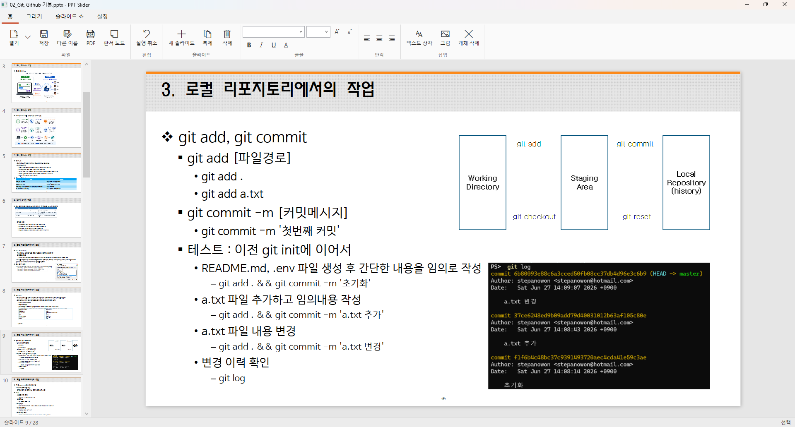
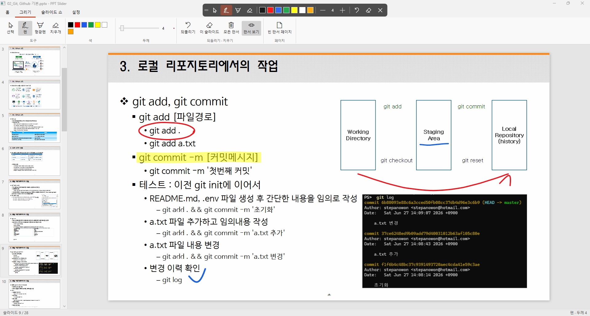
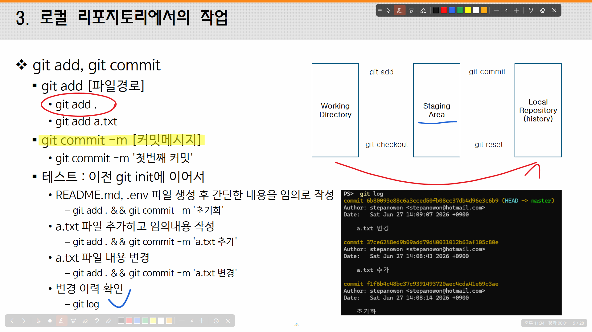
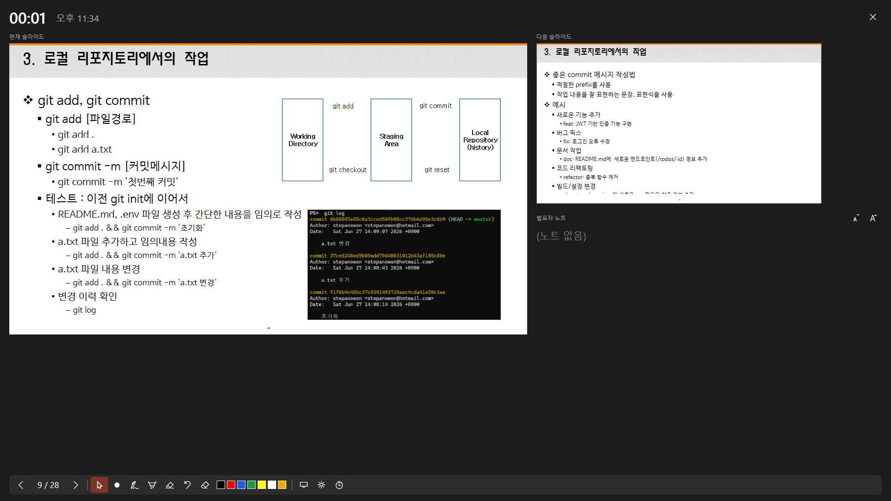

# PPT Slider

**한국어** | [日本語](README.ja.md) | [English](README.en.md)

PowerPoint 없이 `.pptx` 파일을 열어 간단히 편집하고, 판서하면서 발표할 수 있는 Windows 데스크톱 앱입니다 (WPF, .NET 10).



## 설치

<!-- Store 게시 후 STORE_ID를 Partner Center → 제품 ID의 Store ID(9로 시작하는 12자리)로 바꿉니다. -->

**요구 사항**: Windows 10 버전 1809 이상 또는 Windows 11, 64비트(x64). .NET은 앱에 포함되어 있어 따로 설치하지 않아도 됩니다.

### Microsoft Store (권장)

1. [Microsoft Store에서 PPTSlider 열기](https://apps.microsoft.com/detail/STORE_ID) 또는 Microsoft Store 앱에서 "PPTSlider"를 검색합니다.
2. **받기**(또는 **설치**)를 누릅니다.
3. 시작 메뉴에서 **PPTSlider**를 실행합니다.

명령줄로 설치하려면 (winget):

```powershell
winget install --id STORE_ID --source msstore
```

업데이트는 Microsoft Store가 자동으로 설치합니다. 바로 받으려면 Store 앱의 **라이브러리 → 업데이트 받기**를 누릅니다.

### .pptx 파일을 PPTSlider로 열기

설치하면 .pptx 파일의 "연결 프로그램" 목록에 PPTSlider가 추가됩니다.

- 한 번만: 파일을 마우스 오른쪽 버튼으로 클릭 → **연결 프로그램** → **PPTSlider**
- 항상: **설정 → 앱 → 기본 앱**에서 `.pptx`를 검색해 PPTSlider를 고릅니다.

앱 창에 파일을 끌어다 놓거나 **열기**(Ctrl+O)로 열어도 됩니다.

### 제거

**설정 → 앱 → 설치된 앱**에서 PPTSlider의 **⋯ → 제거**를 누릅니다. 최근 파일, 자동 저장 사본, 단축키 · 언어 설정도 함께 지워집니다.
편집한 .pptx 파일과 내보낸 PDF는 그대로 남습니다.

### 직접 빌드해서 쓰기

Store를 쓰지 않으려면 아래 [빌드](#빌드)대로 직접 빌드해 `PptSlider.exe`를 실행하거나, [MSIX 패키지](#msix-패키지)의 로컬 테스트 설치를 따릅니다.


## 주요 기능

### 열기 · 저장 · 내보내기

- `.pptx` 열기(파일 끌어다 놓기, "연결 프로그램" 지원), 저장, 다른 이름으로 저장.
  편집은 OpenXML 문서를 직접 고치므로 앱이 그리지 못하는 요소도 저장 후 그대로 유지됩니다.
- **최근 파일**: 최근 10개를 열기 버튼 옆 목록과 빈 화면에 보여 줍니다.
- **자동 저장**: 2분마다 편집 중인 문서의 사본을 보관하고, 정상 종료하면 지웁니다. 비정상 종료 뒤 같은 파일을 열면 더 최신 사본으로 복구할지 묻습니다.
- **PDF로 내보내기**: 슬라이드마다 한 페이지씩 내보내며, 판서를 포함할지 고를 수 있습니다.
- **판서 노트**: 판서한 슬라이드만 판서와 함께 PDF로 내보냅니다(강의 노트).

### 편집

- 개체 선택, 드래그 이동, 오른쪽 아래 모서리로 크기 조절, 삭제
- 더블클릭(또는 F2)으로 텍스트 제자리 편집 (글꼴, 크기, 색, 정렬 등 원래 서식 유지)
- 굵게 / 기울임꼴 / 밑줄, 글꼴 · 크기 · 색, 단락 정렬 (텍스트 편집 중에는 굵게 · 기울임꼴 · 밑줄 · 글꼴 · 크기가 선택한 글자에만 적용되고, 글꼴 · 크기 상자에 선택한 글자의 값이 표시됩니다)
- 텍스트 상자 · 그림 삽입(그림은 [그림] 버튼, Ctrl+V 붙여넣기, 이미지 파일 끌어다 놓기), 새 슬라이드 · 복제 · 삭제, 실행 취소
- 썸네일을 끌어다 놓아 슬라이드 순서 바꾸기
- "넘치면 텍스트 크기 조정"(normAutofit)이 설정된 텍스트는 상자에 맞게 줄여 그립니다.

### 화면 판서



펜, 형광펜, 지우개, 7가지 색, 두께 조절. 판서는 슬라이드가 아니라 화면 위의 투명한 창에 그려지므로
편집 화면, 슬라이드 쇼는 물론 다른 앱 위에도 그릴 수 있습니다(쇼 중에는 쇼 모니터, 그 밖에는 편집기가 있는 모니터).

- 판서는 슬라이드별로 따로 기억되어, 슬라이드를 넘기면 그 슬라이드에서 그렸던 판서가 다시 나타납니다.
- 화면 위 도구 모음: 포인터(판서는 그대로 두고 아래 화면 클릭) · 펜 · 형광펜 · 지우개 · 색 · 두께 · 되돌리기 · 지우기 · 숨기기. 끌어서 옮길 수 있습니다.
- Shift를 누른 채 그리면 직선이 됩니다. Ctrl+Z는 판서가 있으면 판서 획부터 되돌립니다.
- **빈 판서 페이지**(Ctrl+Enter): 현재 슬라이드 뒤에 빈 슬라이드를 넣고 펜으로 바꿉니다.
- 판서는 .pptx에 저장되지 않으며 앱을 닫으면 사라집니다. 남기려면 PDF 또는 판서 노트로 내보내세요.

### 슬라이드 쇼



처음부터(F5) / 현재 슬라이드부터(Shift+F5). 쇼를 띄울 모니터를 선택할 수 있습니다(기본값: 보조 모니터).

- 검은 화면 / 흰 화면, 레이저 포인터, 번호로 이동(숫자 + Enter), 화면 확대(Z 후 영역 드래그)
- 오른쪽 아래에 현재 시각과 경과 시간 표시, 마우스를 3초 움직이지 않으면 커서 숨김

### 발표자 보기



"발표자 보기 사용"을 켜면 쇼와 다른 모니터에 현재 · 다음 슬라이드, 발표자 노트(글자 크기 조절), 경과 시간을 보여 줍니다.
발표자 보기에서 고른 판서 도구는 쇼 화면 위에 그리며, 쇼와 같은 단축키를 씁니다.

### 그 밖에

- **Break Time**: 5분 ~ 2시간(5분 단위) 전체 화면 휴식 타이머(T).
- **언어**: 한국어 · 日本語 · English. 기본은 Windows 표시 언어를 따르고(한국어 · 일본어가 아니면 영어), [설정] 탭의 언어 목록에서 바꾸면 다시 시작한 뒤 적용됩니다. 선택은 `%APPDATA%\PptSlider\language.txt`에 저장됩니다.
- **단축키 설정**: [설정] 탭의 [단축키 설정]에서 모든 명령의 단축키를 바꿀 수 있으며 `%APPDATA%\PptSlider\shortcuts.json`에 저장됩니다. F1로 목록을 볼 수 있습니다.

### 기본 단축키

| 분류 | 명령 | 키 |
|---|---|---|
| 이동 | 다음 / 이전 슬라이드 | → ↓ PageDown Space Enter N / ← ↑ PageUp Backspace |
| 이동 | 첫 / 마지막 슬라이드 | Home / End |
| 이동 | 번호로 이동 (쇼) | 숫자 + Enter |
| 판서 | 펜 / 형광펜 / 지우개 | P / H / E |
| 판서 | 레이저 포인터 | Ctrl+L |
| 판서 | 색 1~7 | 1~7 (숫자 패드 포함) |
| 판서 | 가늘게 / 굵게 | `[` `-` / `]` `=` |
| 판서 | 현재 슬라이드 판서 지우기 | C |
| 판서 | 빈 판서 페이지 삽입 | Ctrl+Enter |
| 쇼 | 처음부터 / 현재부터 | F5 / Shift+F5 |
| 쇼 | 검은 화면 / 흰 화면 | B `.` / W `,` |
| 쇼 | 화면 확대 | Z |
| 쇼 | Break Time | T |
| 파일 | 열기 / 저장 / 다른 이름으로 저장 | Ctrl+O / Ctrl+S / Ctrl+Shift+S |
| 편집 | 실행 취소(판서 우선) · 텍스트 편집 · 개체 삭제 | Ctrl+Z · F2 · Delete |
| 편집 | 굵게 / 기울임꼴 / 밑줄 | Ctrl+B / Ctrl+I / Ctrl+U |
| 편집 | 글꼴 크기 크게 / 작게 | Ctrl+Shift+. / Ctrl+Shift+, |
| 슬라이드 | 새 슬라이드 / 복제 | Ctrl+M / Ctrl+D |
| 도움말 | 단축키 목록 | F1 |

쇼에서 숫자 키는 번호 이동과 펜 색이 겹칩니다. 숫자 하나만 누르고 1초가 지나면 펜 색으로, 그 안에 Enter나 다음 숫자가 오면 번호 입력으로 처리합니다.

Esc는 고정 키입니다: 텍스트 편집 취소, 확대 해제, 선택 도구로 돌아가기, 슬라이드 쇼 종료 (앞에서부터 하나씩).

### 아직 그리지 않는 요소

차트, 효과(그림자 등), 기본값 외의 표 스타일, 애니메이션은 화면에 표시되지 않습니다. 파일에는 그대로 남아 있습니다.
SmartArt는 PowerPoint가 파일에 저장해 둔 그림(drawing.xml)으로 그리며, 그 그림이 없는 파일에서는 자리 표시 상자만 보입니다.

## 빌드

필요: Windows, [.NET 10 SDK](https://dotnet.microsoft.com/download)

```powershell
cd src
dotnet build -c Release
```

결과물은 저장소 루트의 `bin\Release\net10.0-windows\PptSlider.exe`에 생깁니다.
빌드 출력(`bin/`, `obj/`)은 `src/Directory.Build.props`에서 루트로 지정하며 Git에서 제외됩니다.

### 셀프 테스트

```powershell
PptSlider.exe --selftest deck.pptx outDir
```

모든 슬라이드를 PNG로 렌더링하고, 편집 → 저장 → 다시 열기 과정과 슬라이드 쇼 · 발표자 보기 · 화면 판서 · 그림 삽입 · 순서 바꾸기 · 텍스트 자동 맞춤 · PDF · SmartArt · 최근 파일 · 자동 저장 · 3개 언어 UI 문자열을 검사합니다.
쇼와 발표자 창은 화면 밖에 띄우고 키 입력도 그 창에만 보내므로, 실행 중에 다른 작업을 해도 됩니다.
결과는 `outDir\selftest.txt`에 기록되며 종료 코드 0이면 통과입니다. 앱 데이터는 `outDir\local`을 쓰므로 실제 최근 파일 · 자동 저장에는 영향이 없습니다. 셀프 테스트는 항상 한국어로 실행됩니다.

### 스크린샷

```powershell
PptSlider.exe --screenshots deck.pptx outDir [ko|ja|en] [슬라이드 번호(0부터)]
```

위의 `screen/` 이미지를 만드는 모드입니다. 주 모니터에 편집기를 띄워 편집 화면, 편집 화면 위 판서, 슬라이드 쇼 판서, 발표자 보기(쇼는 다른 모니터)를 차례로 실제 화면에서 캡처합니다.
화면을 그대로 찍으므로 실행하는 동안에는 마우스와 키보드를 건드리지 마세요. 발표자 보기는 모니터가 두 개 이상일 때만 찍습니다.

## MSIX 패키지

```powershell
.\build-msix.ps1           # 로컬 테스트용 (자체 서명)
.\build-msix.ps1 -Store    # Store 제출용 (서명 안 함)
```

self-contained publish → `Package\AppxManifest.xml`과 `Package\Assets` 로고를 더한 레이아웃 → `makeappx pack` → 서명 순서로 진행하며,
결과는 `bin\msix\PptSlider_<버전>_x64.msix`입니다. 패키지 버전은 `src\PptSlider.csproj`의 `Version`을 따릅니다.
Windows SDK가 없으면 `makeappx` · `signtool`이 든 NuGet 패키지 `Microsoft.Windows.SDK.BuildTools`를 `obj\tools`에 내려받아 씁니다.

매니페스트에는 전체 신뢰(runFullTrust) 데스크톱 앱, `.pptx` 파일 연결, 한국어 · 일본어 · 영어(ko-KR, ja-JP, en-US) 리소스가 들어 있습니다.
Store는 이 세 언어마다 스토어 목록(설명 · 스크린샷)을 요구합니다.
로고는 `Package\make-assets.ps1`로 다시 그릴 수 있습니다.
Store 목록에 올리는 문구 · 포스터 아트 · 박스 아트 · 아이콘은 [docs/store-listing.md](docs/store-listing.md)와 `Package\StoreArt`(`Package\make-store-art.ps1`)에 있고, 개인정보처리방침은 [PRIVACY.md](PRIVACY.md)입니다.

### 로컬 테스트 설치

스크립트는 매니페스트의 Publisher와 같은 이름의 자체 서명 인증서를 `Cert:\CurrentUser\My`에 만들고(이미 있으면 재사용) `bin\msix\PptSlider-test.cer`로 내보냅니다.
이 인증서를 한 번만 신뢰하도록 등록한 뒤 설치합니다 (관리자 PowerShell):

```powershell
Import-Certificate -FilePath bin\msix\PptSlider-test.cer -CertStoreLocation Cert:\LocalMachine\TrustedPeople
Add-AppxPackage bin\msix\PptSlider_<버전>_x64.msix
```

### Microsoft Store 제출

1. [Partner Center](https://partner.microsoft.com/dashboard)에서 앱 이름을 예약합니다.
2. **제품 관리 → 제품 ID** 페이지의 값으로 `Package\AppxManifest.xml`을 고칩니다.
   - `Identity`의 `Name` ← Package/Identity/Name
   - `Identity`의 `Publisher` ← Package/Identity/Publisher (`CN=XXXXXXXX-...` 형태, 그대로 복사)
   - `PublisherDisplayName` ← Package/Properties/PublisherDisplayName
   - `DisplayName`과 `uap:VisualElements`의 `DisplayName` ← 예약한 앱 이름
3. `src\PptSlider.csproj`의 `Version`을 올립니다. Store는 같은 버전을 다시 받지 않습니다.
4. `.\build-msix.ps1 -Store`로 만든 `.msix`를 제출물의 패키지 항목에 올립니다. 서명은 Store가 합니다.
5. `runFullTrust`는 제한된 기능이라 제출할 때 사용 이유를 적어야 합니다 (예: "WPF 데스크톱 앱이며 사용자가 연 .pptx 파일을 읽고 씁니다").

> **앱 이름 주의**: "PPT"는 Microsoft PowerPoint와 연관된 이름이라 Store 심사에서 상표 문제로 지적될 수 있습니다.
> 예약할 이름에는 "PPT" · "PowerPoint"를 넣지 않는 편이 안전하며, 설명에서 ".pptx 파일을 연다"처럼 파일 형식으로만 언급하는 것을 권합니다.

패키지로 설치한 앱에서는 `%LOCALAPPDATA%` · `%APPDATA%` 쓰기가 패키지 전용 폴더로 리디렉션될 수 있습니다. 최근 파일 · 자동 저장 · 단축키 설정 · 언어 선택은 그 안에 저장되며, 앱을 제거하면 함께 지워집니다.

## 폴더 구조

```
build-msix.ps1          MSIX 패키지 빌드
Package/                AppxManifest.xml, Assets(로고), StoreArt(Store 이미지), make-assets.ps1, make-store-art.ps1
screen/                 README와 Store용 스크린샷 (ko, ja, en)
docs/                   store-listing.md(Store 목록 문구)
src/
├─ App.xaml(.cs)        진입점 (--selftest 처리, 시작 시 파일 열기)
├─ Views/               MainWindow(편집기), ShowWindow(슬라이드 쇼), PresenterWindow(발표자 보기),
│                       InkOverlay(화면 판서), BreakWindow(휴식 타이머), ShortcutsWindow(단축키 설정)
├─ Models/              Deck(.pptx 문서 · 편집 · 저장 · 실행 취소), PenState(판서 도구 상태), InkHistory(판서 되돌리기)
├─ Rendering/           SlideRenderer(PPTX → WPF 렌더링, SmartArt 포함)
├─ Services/            Shortcuts(단축키), Monitors(모니터 목록), PdfExport(PDF),
│                       RecentFiles(최근 파일), AutoSave(자동 저장), AppPaths(앱 데이터 폴더), Loc(한 · 일 · 영 UI 문자열)
└─ Diagnostics/         SelfTest (편집 · 쇼 · 판서 · 뷰어 검사), Screenshots (스크린샷)
```

의존 패키지: [DocumentFormat.OpenXml](https://www.nuget.org/packages/DocumentFormat.OpenXml)
