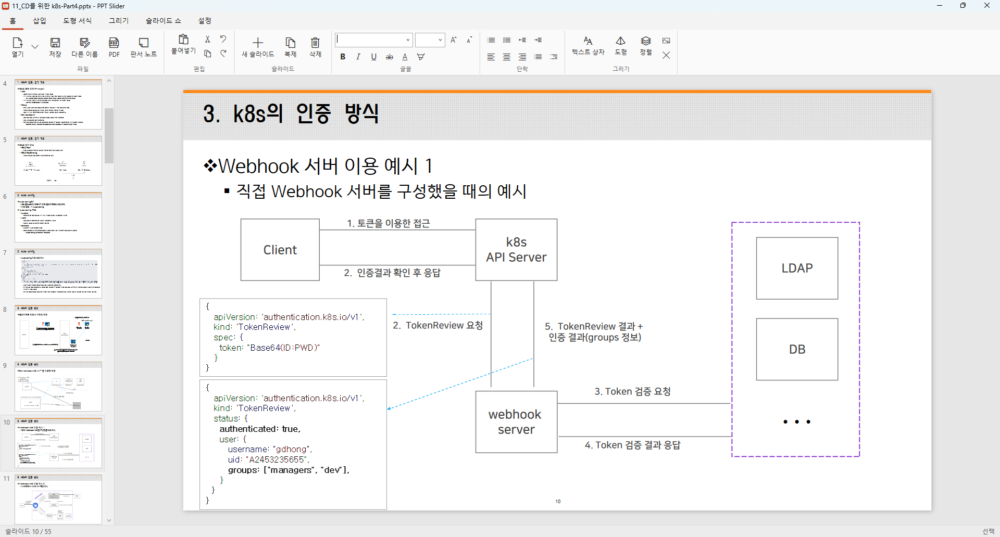
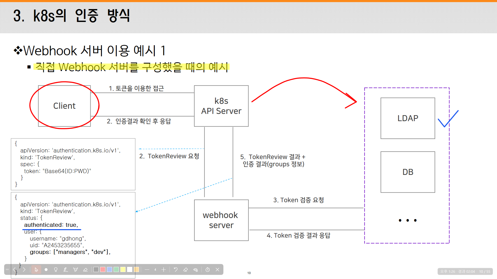
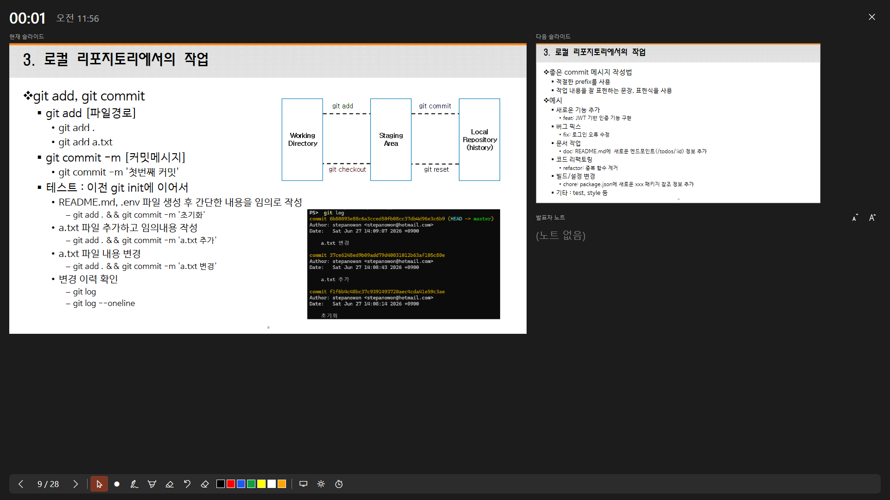
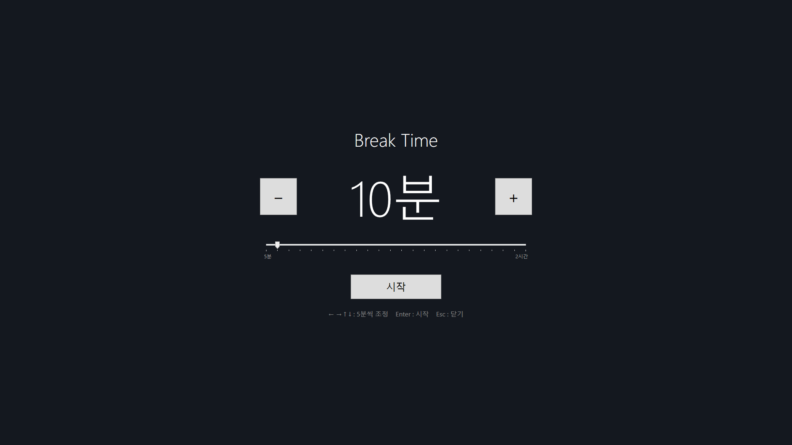
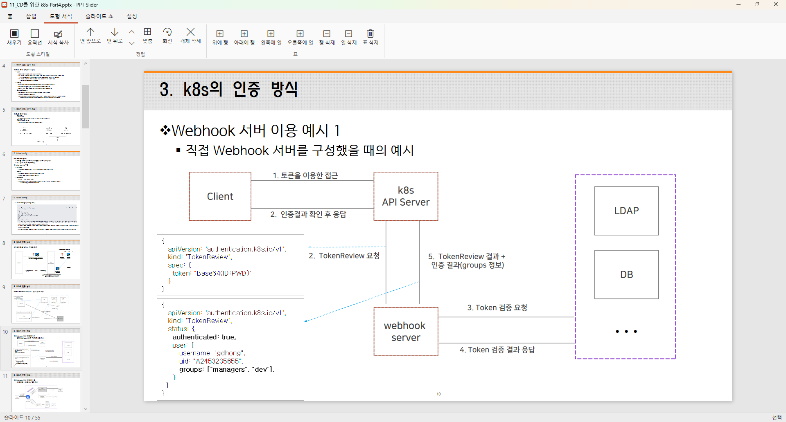

# PPT Slider

**한국어** | [日本語](README.ja.md) | [English](README.en.md)

`.pptx` 파일을 열어 간단히 고치고, 슬라이드 쇼 위에 판서하면서 발표하는 가벼운 Windows 앱입니다.
강의, 수업, 세미나처럼 슬라이드 위에 직접 쓰고 그리며 설명하는 발표에 맞춰 만들었습니다. PowerPoint가 없어도 됩니다.

<a href="https://apps.microsoft.com/detail/9PL1M72JXSCN?mode=direct"></a>



## 한눈에 보기

- **쇼 판서**: 슬라이드 쇼 위에 펜 · 형광펜 · 지우개 · 레이저 포인터로 그립니다. 판서는 슬라이드별로 기억됩니다. 편집 화면에서는 판서하지 않습니다.
- **슬라이드 쇼와 발표자 보기**: 쇼 모니터 선택, 다른 모니터에 현재 · 다음 슬라이드와 노트, 검은 화면 · 스팟 하이라이트 · 화면 확대 · 휴식 타이머.
- **편집**: 텍스트 제자리 편집, 도형 19종, 표, 그림, 서식 복사, 실행 취소. 앱이 표시하지 못하는 요소도 파일에 그대로 남습니다.
- **원본에 가까운 표시**: 줄 간격, 글머리 기호, 한글 줄바꿈, 글자 간격을 PowerPoint와 같은 규칙으로 그립니다.
- **판서 노트**: 판서한 슬라이드만 판서와 함께 PDF로 내보내 강의 노트로 나눠 줍니다.
- 한국어 · 日本語 · English 화면, 모든 단축키 바꾸기, 자동 저장과 복구. 인터넷에 아무것도 보내지 않습니다.

## 설치

**요구 사항**: Windows 10 버전 1809 이상 또는 Windows 11, 64비트(x64). .NET은 앱에 포함되어 있어 따로 설치하지 않아도 됩니다.

### Microsoft Store (권장)

1. 위의 배지를 누르거나 Microsoft Store 앱에서 "PPTSlider"를 검색합니다.
2. **받기**(또는 **설치**)를 누릅니다.
3. 시작 메뉴에서 **PPTSlider**를 실행합니다.

명령줄로 설치하려면 (winget):

```powershell
winget install --id 9PL1M72JXSCN --source msstore
```

업데이트는 Microsoft Store가 자동으로 설치합니다. 바로 받으려면 Store 앱의 **라이브러리 → 업데이트 받기**를 누릅니다.

### 휴대용 zip (GitHub 릴리스)

[릴리스 페이지](https://github.com/stepanowon/ppt-slider/releases/latest)에서 `PptSlider-<버전>-win-x64.zip`을 받아 원하는 폴더에 풀고 `PptSlider.exe`를 실행합니다. 설치 과정이 없고 .NET도 들어 있습니다.

- 서명되지 않은 실행 파일이라 처음 실행할 때 "Windows의 PC 보호" 창이 뜰 수 있습니다. **추가 정보 → 실행**을 누릅니다.
- "연결 프로그램"에 자동으로 추가되지 않고 자동 업데이트도 없습니다. 새 버전은 릴리스 페이지에서 받습니다.

### .pptx 파일을 PPTSlider로 열기

Store로 설치하면 .pptx 파일의 "연결 프로그램" 목록에 PPTSlider가 추가됩니다.

- 한 번만: 파일을 마우스 오른쪽 버튼으로 클릭 → **연결 프로그램** → **PPTSlider**
- 항상: **설정 → 앱 → 기본 앱**에서 `.pptx`를 검색해 PPTSlider를 고릅니다.

앱 창에 파일을 끌어다 놓거나 **열기**(Ctrl+O), **최근 파일**로 열어도 됩니다.

### 제거

**설정 → 앱 → 설치된 앱**에서 PPTSlider의 **⋯ → 제거**를 누릅니다. 최근 파일, 자동 저장 사본, 단축키 · 언어 설정도 함께 지워집니다.
편집한 .pptx 파일과 내보낸 PDF는 그대로 남습니다. 휴대용 zip은 폴더를 지우면 됩니다.

## 빠르게 시작하기

1. `.pptx` 파일을 앱 창에 끌어다 놓습니다.
2. **슬라이드 쇼** 탭에서 쇼를 띄울 모니터를 고르고, 모니터가 두 개 이상이면 **발표자 보기 사용**을 켭니다.
3. **F5**로 처음부터, **Shift+F5**로 현재 슬라이드부터 쇼를 시작합니다.
4. 쇼에서 **P**(펜) · **H**(형광펜) · **E**(지우개)로 판서하고, **1~7**로 색을 바꾸고, **Esc**로 포인터로 돌아옵니다. 다시 **Esc**를 누르면 쇼가 끝납니다.
5. 끝난 뒤 **홈 → 판서 노트**로 판서한 슬라이드를 PDF로 남깁니다.

**F1**을 누르면 모든 단축키를 볼 수 있습니다.

## 판서 (슬라이드 쇼 전용)



판서는 **슬라이드 쇼에서만** 할 수 있습니다. 쇼 화면 위의 투명한 층에 그려지며 슬라이드 자체는 바뀌지 않습니다. 편집 화면에서는 펜 · 형광펜 · 지우개를 고를 수 없고 판서도 나타나지 않으며, 리본의 **그리기** 탭은 쇼가 진행되는 동안에만 나타납니다.

- **도구**: 펜, 형광펜, 지우개, 레이저 포인터(쇼에서), 7가지 색(검정 · 빨강 · 파랑 · 초록 · 노랑 · 흰색 · 주황), 두께 조절.
- **슬라이드별 기억**: 슬라이드를 넘겼다가 돌아오면 그 슬라이드에서 그렸던 판서가 다시 나타납니다. 검은 화면 · 흰 화면에서는 빈 판서 층이 새로 열려 슬라이드의 판서와 섞이지 않습니다(다시 띄우면 빈 화면에서 시작합니다).
- **화면 위 도구 모음**: 포인터(판서는 그대로 두고 아래 화면 클릭) · 펜 · 형광펜 · 지우개 · 색 · 두께 · 되돌리기 · 지우기 · 숨기기. 손잡이를 끌어 원하는 곳으로 옮깁니다.
- **직선**: Shift를 누른 채 그리면 직선이 됩니다.
- **되돌리기**: 쇼에서는 Ctrl+Z나 도구 모음의 되돌리기 버튼으로 판서 획을 되돌립니다. 편집 화면의 Ctrl+Z는 슬라이드 편집만 되돌립니다. 판서 되돌리기는 슬라이드마다 최근 200번까지 기억합니다.
- **지우기**: C는 현재 슬라이드의 판서를, 쇼 중의 **그리기 → 모든 판서**는 모든 슬라이드의 판서를 지웁니다.
- **빈 판서 페이지**(Ctrl+Enter): 현재 슬라이드 뒤에 빈 슬라이드를 넣고, 쇼 중이면 펜으로 바꿉니다. 판서 공간이 더 필요할 때 씁니다.
- 쇼를 마치면 판서는 화면에서 사라지지만 슬라이드별로 남아 있어 다음 쇼와 PDF · 판서 노트에 들어갑니다. .pptx에는 저장되지 않으며 앱을 닫으면 사라집니다. 남기려면 PDF 또는 판서 노트로 내보내세요.

## 슬라이드 쇼

처음부터(F5) 또는 현재 슬라이드부터(Shift+F5) 시작하며, 쇼를 띄울 모니터를 고를 수 있습니다(기본값: 보조 모니터).

- **넘기기**: 클릭, 마우스 휠, 화살표 · Space · Enter · PageDown 등. 번호를 누르고 Enter로 그 슬라이드로 이동합니다.
- **검은 화면 / 흰 화면**(B / W): 청중의 시선을 잠시 거둡니다. 그 위에 판서할 수도 있습니다.
- **레이저 포인터**(Ctrl+L), **스팟 하이라이트**(S: 마우스 포인터 주위에 노란 원, 판서 중에도 표시).
- **화면 확대**(Z 후 영역 드래그, Esc로 해제).
- **도구 모음**: 왼쪽 아래에 이전 · 다음, 판서 도구, 레이저, 스팟 하이라이트, 휴식, 쇼 마침 버튼이 있습니다.
- 오른쪽 아래에 현재 시각과 경과 시간을 표시하고, 마우스를 3초 움직이지 않으면 커서를 숨깁니다.
- 쇼 화면은 항상 맨 위에 있지 않습니다. 쇼 중에도 브라우저 같은 다른 창을 쇼 위에 띄워 보여 줄 수 있고, 작업 표시줄이나 Alt+Tab으로 쇼로 돌아옵니다.

쇼에서 숫자 키는 번호 이동과 펜 색이 겹칩니다. 숫자 하나만 누르고 1초가 지나면 펜 색으로, 그 안에 Enter나 다음 숫자가 오면 번호 입력으로 처리합니다.

## 발표자 보기



**슬라이드 쇼 → 발표자 보기 사용**을 켜면 쇼와 다른 모니터에 발표자 보기를 띄웁니다(모니터가 하나면 띄우지 않습니다).

- 현재 슬라이드, 다음 슬라이드, 발표자 노트(글자 크기 조절), 현재 시각과 경과 시간.
- 발표자 보기에서 고른 판서 도구는 쇼 화면 위에 그립니다. 레이저 포인터는 발표자 보기의 슬라이드 위에서 움직여도 쇼 화면에 나타납니다.
- 슬라이드를 클릭하거나 마우스 휠로 넘깁니다.
- 이전 · 다음, 검은 화면 · 흰 화면(청중 화면 상태 표시), 판서 되돌리기 · 지우기, 휴식, 쇼 마침 버튼. 쇼와 같은 단축키를 씁니다.

## Break Time



전체 화면 휴식 타이머입니다(T, 또는 슬라이드 쇼 탭 · 쇼 도구 모음의 휴식 버튼).
5분 ~ 2시간을 5분 단위로 고르고(화살표 키) Enter로 시작합니다. 다시 시작할 시각을 보여 주며, Space로 일시 정지 · 계속, Esc로 닫습니다.

## 편집

리본은 **홈 · 삽입 · 도형 서식 · 슬라이드 쇼 · 설정** 탭으로 되어 있고, **그리기** 탭은 슬라이드 쇼 중에만 나타납니다. 편집은 OpenXML 문서를 직접 고치므로, 앱이 그리지 못하는 요소도 저장한 뒤 그대로 남습니다.



### 개체 다루기

- 선택: 클릭, Shift/Ctrl+클릭, 끌어서 범위 선택, Ctrl+A로 모두 선택
- 끌어서 이동, 8방향 핸들로 크기 조절(Shift: 비율 유지), 위쪽 원을 끌어 회전, 화살표 키로 이동(Ctrl+화살표: 미세 이동), Delete로 삭제
- 잘라내기 · 복사 · 붙여넣기(다른 슬라이드로, 그림과 텍스트 포함), Ctrl+D로 복제
- 순서(맨 앞 · 맨 뒤 · 앞으로 · 뒤로), 맞춤(왼쪽 · 가운데 · 오른쪽 · 위 · 중간 · 아래: 여러 개는 서로, 하나는 슬라이드에), 90° 회전 · 상하 / 좌우 대칭
- **서식 복사**: 붓 버튼을 누른 뒤 다른 개체를 클릭하거나, Ctrl+Shift+C / Ctrl+Shift+V
- 실행 취소 / 다시 실행(최근 100번의 편집까지)

### 텍스트

- 더블클릭(또는 F2)으로 제자리 편집. 원래 글꼴 · 크기 · 색 · 정렬을 유지하며, 바깥을 클릭하면 적용되고 Esc는 취소, Shift+Enter는 줄 바꿈입니다.
- 글꼴 · 크기 · 색, 굵게 · 기울임꼴 · 밑줄 · 취소선, 텍스트 강조 색, 글꼴 크기 크게 / 작게.
  편집 중에는 선택한 글자에만 적용되고, 글꼴 · 크기 상자에 선택한 글자의 값이 표시됩니다.
- 왼쪽 · 가운데 · 오른쪽 · 양쪽 맞춤, 줄 간격, 글머리 기호 · 번호 매기기, 목록 수준(Alt+Shift+→ / ←).
- "넘치면 텍스트 크기 조정"(normAutofit)이 설정된 텍스트는 상자에 맞게 줄여 그립니다.

### 도형 · 표 · 그림

- **도형 19종**: 사각형, 모서리가 둥근 사각형, 타원, 삼각형, 직각 삼각형, 다이아몬드, 평행 사변형, 사다리꼴, 오각형, 육각형, 오각형 화살표, 갈매기형 수장, 별, 상하좌우 화살표, 선, 화살표 선.
  고른 뒤 슬라이드에서 끌어서 그립니다(Shift: 정사각형 / 원). **도형 서식** 탭에서 채우기 · 윤곽선 색, 두께, 대시(실선 · 점선 · 파선 · 긴 파선-점선)를 바꿉니다.
- **표**: 칸을 골라 행 × 열 수를 정해 넣습니다. 셀을 클릭해 바로 편집하고 Tab / Shift+Tab으로 셀을 옮기며, 마지막 셀에서 Tab은 행을 추가합니다. 위 · 아래에 행, 왼쪽 · 오른쪽에 열 삽입, 행 · 열 · 표 삭제. 병합된 셀도 처리합니다.
- **텍스트 상자**, **그림**: [그림] 버튼, Ctrl+V 붙여넣기, 이미지 파일 끌어다 놓기(png · jpg · gif · bmp).

### 슬라이드

- 새 슬라이드(Ctrl+M), 복제, 삭제(삭제는 실행 취소할 수 없어 확인을 묻습니다).
- 왼쪽 썸네일을 끌어다 놓아 순서를 바꿉니다.

## 열기 · 저장 · 내보내기

- **열기**: 끌어다 놓기, "연결 프로그램", Ctrl+O. **최근 파일** 최근 10개를 열기 버튼 옆 목록과 빈 화면에 보여 줍니다.
- **저장 / 다른 이름으로 저장**: Ctrl+S / Ctrl+Shift+S. 저장하지 않고 닫으면 저장할지 묻습니다.
- **자동 저장**: 2분마다 편집 중인 문서의 사본을 보관하고, 정상 종료하면 지웁니다. 비정상 종료 뒤 같은 파일을 열면 더 최신 사본으로 복구할지 묻습니다.
- **PDF로 내보내기**: 슬라이드마다 한 페이지씩 내보내며, 판서를 포함할지 고를 수 있습니다.
- **판서 노트**: 판서한 슬라이드만 판서와 함께 PDF로 내보냅니다(파일 이름 끝에 `_판서노트`).

## 원본에 가깝게 그리기

슬라이드는 PowerPoint와 같은 규칙으로 배치합니다.

- 한 줄의 높이는 글자 크기의 1.2배이고, 텍스트 상자의 첫 문단에는 단락 앞 간격을 넣지 않습니다.
- 글머리 기호는 내어쓰기로 두어, 둘째 줄부터 본문 위치에서 시작합니다.
- 한글 줄바꿈은 문서의 설정(단어 단위 / 글자 단위)을 따르고, "diff를"처럼 영문에 붙은 조사는 떼지 않습니다.
- 글자 간격, 슬라이드 번호 필드, 표의 테마 글꼴 · 첫 열 강조 · 밝게 / 어둡게 한 색, 아주 가는 선을 반영합니다.
- SmartArt는 PowerPoint가 파일에 저장해 둔 그림(drawing.xml)으로 그립니다.

글꼴이 같아도 글자 모양은 몇 픽셀 다를 수 있습니다. 글자 간격은 문단의 가로 배율로 맞추므로 글자가 조금 좁거나 넓어 보일 수 있습니다.

**표시하지 않는 요소**: 차트, 효과(그림자 등), 기본값 외의 표 스타일, 애니메이션, 저장된 그림이 없는 SmartArt(자리 표시 상자만 보임). 화면에 그리지 않을 뿐 파일에는 그대로 남아 있습니다.

## 설정

**설정** 탭에서 바꿉니다.

- **언어**: 한국어 · 日本語 · English. 기본은 Windows 표시 언어를 따르고(한국어 · 일본어가 아니면 영어), 바꾸면 다시 시작한 뒤 적용됩니다.
- **단축키 설정**: 모든 명령의 단축키를 바꿀 수 있고, 한 명령에 여러 키를 지정할 수 있습니다. 이미 쓰이는 키를 고르면 옮길지 묻습니다. 기능별 · 전체 기본값 되돌리기를 지원합니다.
  Esc는 고정 키로, 텍스트 편집 취소 → 확대 해제 → 선택 도구로 돌아가기 → 슬라이드 쇼 종료 순으로 하나씩 처리합니다.

### 기본 단축키

| 분류 | 명령 | 키 |
|---|---|---|
| 이동 | 다음 / 이전 슬라이드 | → ↓ PageDown Space Enter N / ← ↑ PageUp Backspace |
| 이동 | 첫 / 마지막 슬라이드 | Home / End |
| 이동 | 번호로 이동 (쇼) | 숫자 + Enter |
| 판서 | 펜 / 형광펜 / 지우개 | P / H / E |
| 판서 | 레이저 포인터 | Ctrl+L |
| 판서 | 색 1~7 | 1~7 (숫자 패드 포함) |
| 판서 | 가늘게 / 굵게 | `[` `-` / `]` `=` (숫자 패드 `-` / `+` 포함) |
| 판서 | 현재 슬라이드 판서 지우기 | C |
| 판서 | 빈 판서 페이지 삽입 | Ctrl+Enter |
| 쇼 | 처음부터 / 현재부터 | F5 / Shift+F5 |
| 쇼 | 검은 화면 / 흰 화면 | B `.` / W `,` |
| 쇼 | 화면 확대 | Z |
| 쇼 | 스팟 하이라이트 | S |
| 쇼 | Break Time | T |
| 파일 | 열기 / 저장 / 다른 이름으로 저장 | Ctrl+O / Ctrl+S / Ctrl+Shift+S |
| 편집 | 실행 취소(쇼 중에는 판서 우선) / 다시 실행 | Ctrl+Z / Ctrl+Y |
| 편집 | 텍스트 편집 / 개체 삭제 | F2 / Delete |
| 편집 | 잘라내기 / 복사 / 붙여넣기 / 모두 선택 | Ctrl+X / Ctrl+C / Ctrl+V / Ctrl+A |
| 편집 | 서식 복사 / 서식 붙여넣기 | Ctrl+Shift+C / Ctrl+Shift+V |
| 편집 | 개체 이동 (미세 이동) | 화살표 (Ctrl+화살표) |
| 편집 | 맨 앞 / 맨 뒤로, 앞 / 뒤로 | Ctrl+Shift+] / Ctrl+Shift+[, Ctrl+] / Ctrl+[ |
| 편집 | 목록 수준 늘림 / 줄임 | Alt+Shift+→ / Alt+Shift+← |
| 편집 | 표에서 다음 / 이전 셀 | Tab / Shift+Tab |
| 편집 | 굵게 / 기울임꼴 / 밑줄 | Ctrl+B / Ctrl+I / Ctrl+U |
| 편집 | 글꼴 크기 크게 / 작게 | Ctrl+Shift+. / Ctrl+Shift+, |
| 슬라이드 | 새 슬라이드 / 복제(선택한 개체가 있으면 개체) | Ctrl+M / Ctrl+D |
| 도움말 | 단축키 목록 | F1 |

## 데이터와 개인정보

앱은 개인 정보를 수집하지 않고 인터넷으로 아무것도 보내지 않습니다([개인정보처리방침](PRIVACY.md)). 앱이 쓰는 파일은 다음뿐입니다.

| 내용 | 위치 |
|---|---|
| 최근 파일, 자동 저장 사본 | `%LOCALAPPDATA%\PptSlider` |
| 언어 선택(`language.txt`), 단축키(`shortcuts.json`) | `%APPDATA%\PptSlider` |

Store로 설치한 앱에서는 이 위치가 패키지 전용 폴더로 리디렉션될 수 있으며, 앱을 제거하면 함께 지워집니다.

## 개발

### 빌드

필요: Windows, [.NET 10 SDK](https://dotnet.microsoft.com/download). WPF 앱이며 의존 패키지는 [DocumentFormat.OpenXml](https://www.nuget.org/packages/DocumentFormat.OpenXml) 하나입니다.

```powershell
cd src
dotnet build -c Release
```

결과물은 저장소 루트의 `bin\Release\net10.0-windows\PptSlider.exe`에 생깁니다.
빌드 출력(`bin/`, `obj/`)은 `src/Directory.Build.props`에서 루트로 지정하며 Git에서 제외됩니다.

휴대용 zip은 self-contained로 게시해 만듭니다.

```powershell
dotnet publish src\PptSlider.csproj -c Release -r win-x64 --self-contained true -o out\PptSlider-<버전>-win-x64
```

### 진단 모드

`PptSlider.exe`에 명령줄 옵션을 주면 창을 띄우지 않거나 화면 밖에서 검사를 돌립니다.

| 명령 | 하는 일 | 결과 |
|---|---|---|
| `--selftest deck.pptx outDir` | 셀프 테스트 (아래) | `outDir\selftest.txt`, 종료 코드 0이면 통과 |
| `--render deck.pptx outDir [너비]` | 모든 슬라이드를 PNG로 저장(기본 너비 1280). PowerPoint에서 내보낸 이미지와 나란히 놓고 렌더링 차이를 봅니다. | `outDir\01.png`, `02.png` … |
| `--leak deck.pptx outDir` | 메모리 측정 (아래) | `outDir\leak.txt` |
| `--screenshots deck.pptx outDir [ko\|ja\|en] [슬라이드 번호(0부터)]` | README · Store용 `screen/` 이미지를 실제 화면에서 캡처 | `outDir\*.png` |

**셀프 테스트**는 모든 슬라이드를 렌더링하고, 편집 → 저장 → 다시 열기 과정과 슬라이드 쇼 · 발표자 보기 · 쇼 판서(편집 화면에서는 막힘) · 그림 삽입 · 순서 바꾸기 · 텍스트 자동 맞춤 · 도형 · 표 · 클립보드 · 서식 복사 · 마우스 / 키보드 편집 · 단축키 중복 · PDF · SmartArt · 최근 파일 · 자동 저장 · 3개 언어 UI 문자열을 검사합니다.
PowerPoint와 같게 그리는 규칙(줄 높이, 글머리 기호, 한글 줄바꿈, 글자 간격 등), 메모리 누수(닫은 쇼 창이 메모리에서 지워지는지), 실행 취소 상한, 쇼 화면이 항상 맨 위에 있지 않은지도 확인합니다.
쇼와 발표자 창은 화면 밖에 띄우고 키 입력도 그 창에만 보내므로, 실행 중에 다른 작업을 해도 됩니다. 앱 데이터는 `outDir\local`을 쓰므로 실제 최근 파일 · 자동 저장에는 영향이 없습니다. 셀프 테스트는 항상 한국어로 실행됩니다.

**메모리 측정**은 슬라이드 이동, 쇼 열고 닫기, 파일 다시 열기, 텍스트 편집, 개체 이동, 판서, 창 열고 닫기 등을 수십 번씩 반복하면서 매번 GC 뒤의 메모리와 닫은 창 · 이전 문서가 메모리에서 지워졌는지를 기록합니다.
환경 변수 `LEAK_OPENS`(파일 다시 열기 횟수, 기본 40)와 `LEAK_COMPACT`(1: 대형 개체 힙 압축, 2: 남은 메모리를 Windows에 돌려주는 GC)로 측정 방식을 바꿀 수 있습니다.

**스크린샷** 모드는 주 모니터에 편집기를 띄워 편집 화면, 도형 서식(여러 개체 선택), 슬라이드 쇼 판서, Break Time, 발표자 보기(쇼는 다른 모니터)를 차례로 캡처합니다. 화면을 그대로 찍으므로 실행하는 동안에는 마우스와 키보드를 건드리지 마세요. 발표자 보기는 모니터가 두 개 이상일 때만 찍습니다.

### MSIX 패키지

```powershell
.\build-msix.ps1           # 로컬 테스트용 (자체 서명)
.\build-msix.ps1 -Store    # Store 제출용 (서명 안 함)
```

self-contained publish → `Package\AppxManifest.xml`과 `Package\Assets` 로고를 더한 레이아웃 → `makeappx pack` → 서명 순서로 진행하며,
결과는 `bin\msix\PptSlider_<버전>_x64.msix`입니다. 패키지 버전은 `src\PptSlider.csproj`의 `Version`을 따릅니다.
Windows SDK가 없으면 `makeappx` · `signtool`이 든 NuGet 패키지 `Microsoft.Windows.SDK.BuildTools`를 `obj\tools`에 내려받아 씁니다.

매니페스트에는 전체 신뢰(runFullTrust) 데스크톱 앱, `.pptx` 파일 연결, 한국어 · 일본어 · 영어(ko-KR, ja-JP, en-US) 리소스가 들어 있습니다.
로고는 `Package\make-assets.ps1`로 다시 그릴 수 있습니다.

**로컬 테스트 설치**: 스크립트는 매니페스트의 Publisher와 같은 이름의 자체 서명 인증서를 `Cert:\CurrentUser\My`에 만들고(이미 있으면 재사용) `bin\msix\PptSlider-test.cer`로 내보냅니다.
이 인증서를 한 번만 신뢰하도록 등록한 뒤 설치합니다 (관리자 PowerShell):

```powershell
Import-Certificate -FilePath bin\msix\PptSlider-test.cer -CertStoreLocation Cert:\LocalMachine\TrustedPeople
Add-AppxPackage bin\msix\PptSlider_<버전>_x64.msix
```

### Microsoft Store 제출

1. [Partner Center](https://partner.microsoft.com/dashboard)에서 앱 이름을 예약합니다.
2. **제품 관리 → 제품 ID** 페이지의 값으로 `Package\AppxManifest.xml`을 고칩니다.
   - `Identity`의 `Name` ← Package/Identity/Name
   - `Identity`의 `Publisher` ← Package/Identity/Publisher (`CN=XXXXXXXX-...` 형태, 그대로 복사)
   - `PublisherDisplayName` ← Package/Properties/PublisherDisplayName
   - `DisplayName`과 `uap:VisualElements`의 `DisplayName` ← 예약한 앱 이름
3. `src\PptSlider.csproj`의 `Version`을 올립니다. Store는 같은 버전을 다시 받지 않습니다.
4. `.\build-msix.ps1 -Store`로 만든 `.msix`를 제출물의 패키지 항목에 올립니다. 서명은 Store가 합니다.
5. `runFullTrust`는 제한된 기능이라 제출할 때 사용 이유를 적어야 합니다 (예: "WPF 데스크톱 앱이며 사용자가 연 .pptx 파일을 읽고 씁니다").

Store는 세 언어마다 스토어 목록(설명 · 스크린샷)을 요구합니다. 목록 문구는 [docs/store-listing.md](docs/store-listing.md), 포스터 아트 · 박스 아트 · 아이콘은 `Package\StoreArt`(`Package\make-store-art.ps1`), 개인정보처리방침은 [PRIVACY.md](PRIVACY.md)에 있습니다.

> **앱 이름 주의**: "PPT"는 Microsoft PowerPoint와 연관된 이름이라 Store 심사에서 상표 문제로 지적될 수 있습니다.
> 예약할 이름에는 "PPT" · "PowerPoint"를 넣지 않는 편이 안전하며, 설명에서 ".pptx 파일을 연다"처럼 파일 형식으로만 언급하는 것을 권합니다.

### 폴더 구조

```
build-msix.ps1          MSIX 패키지 빌드
Package/                AppxManifest.xml, Assets(로고), StoreArt(Store 이미지), make-assets.ps1, make-store-art.ps1
screen/                 README와 Store용 스크린샷 (ko, ja, en)
docs/                   store-listing.md(Store 목록 문구), 테스트계획 · 테스트결과(버전별)
src/
├─ App.xaml(.cs)        진입점 (--selftest · --screenshots · --render · --leak 처리, 시작 시 파일 열기)
├─ Views/               MainWindow(편집기), ShowWindow(슬라이드 쇼), PresenterWindow(발표자 보기),
│                       InkOverlay(쇼 위의 판서 층), BreakWindow(휴식 타이머), ShortcutsWindow(단축키 설정),
│                       PenToolbar(판서 도구 막대), WindowHooks(창이 닫힐 때 이벤트 구독 해제)
├─ Editing/             편집 부품(IEditorHost에만 의존): ShapeSelection(선택), SelectionAdorner(핸들), StageInteraction(마우스),
│                       TextEditor(제자리 텍스트 편집), Shape · Text · Table · Insert · ClipboardCommands(명령), FormatPainterTool(서식 복사),
│                       EditingParts(부품 조립)
├─ Models/              Deck(.pptx 문서 · 저장 · 슬라이드 목록), EditHistory(실행 취소), ShapeFactory · ShapeLayout · ShapeStyle(도형),
│                       Tables(표), TextContent · TextFormat(텍스트와 서식), ShapeClipboard · FormatPainter(복사), SlideTree · Ooxml · X(XML 도우미),
│                       PenState(판서 도구 상태), InkManager(슬라이드별 · 검은 화면 판서), InkHistory(판서 되돌리기),
│                       ShowSession(쇼 상태: 검은 화면, 번호 입력, 레이저, 스팟 하이라이트), BoundedStack(개수 제한 실행 취소)
├─ Rendering/           SlideRenderer(PPTX → WPF 렌더링, SmartArt 포함), ShapeGeometry(도형 윤곽), ColorMath(색), FontNames(글꼴 이름 검사), TextPanel, ShapeHit
├─ Services/            Shortcuts(단축키), Monitors(모니터 목록), PdfExport(PDF),
│                       RecentFiles(최근 파일), AutoSave(자동 저장), AppPaths(앱 데이터 폴더), Loc(한 · 일 · 영 UI 문자열)
└─ Diagnostics/         SelfTest (편집 · 쇼 · 판서 · 뷰어 · 렌더링 규칙 · 메모리 누수 검사), Screenshots (스크린샷),
                        RenderDump (--render), LeakProbe (--leak)
```

## 라이선스

[MIT 라이선스](LICENSE)입니다. 저작권 표시와 라이선스 문구를 남기면 누구나 사용 · 수정 · 재배포할 수 있습니다.
함께 배포되는 외부 구성 요소(Open XML SDK, .NET 런타임)의 라이선스는 [THIRD-PARTY-NOTICES.txt](THIRD-PARTY-NOTICES.txt)에 있으며, 빌드 결과물과 MSIX 패키지에도 함께 들어갑니다.
